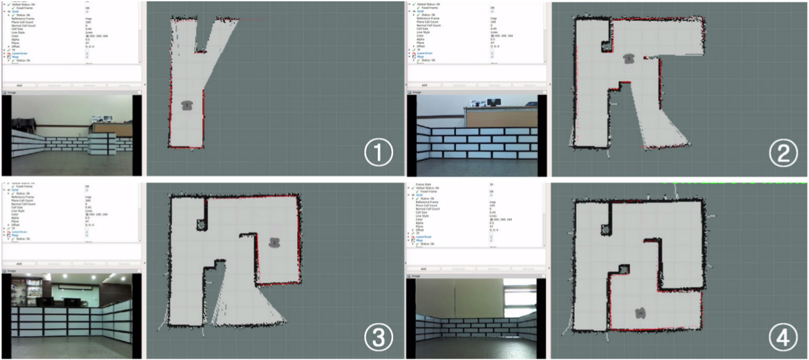
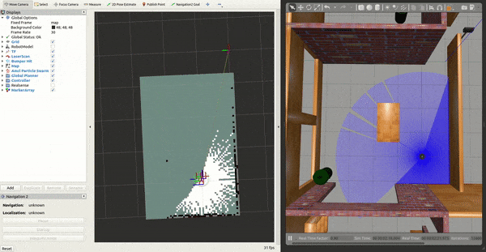
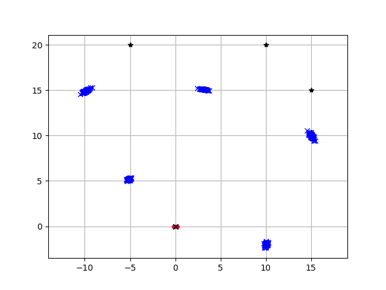
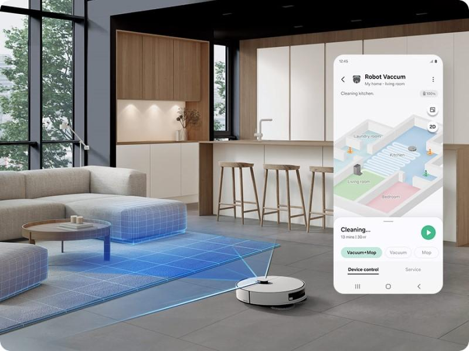
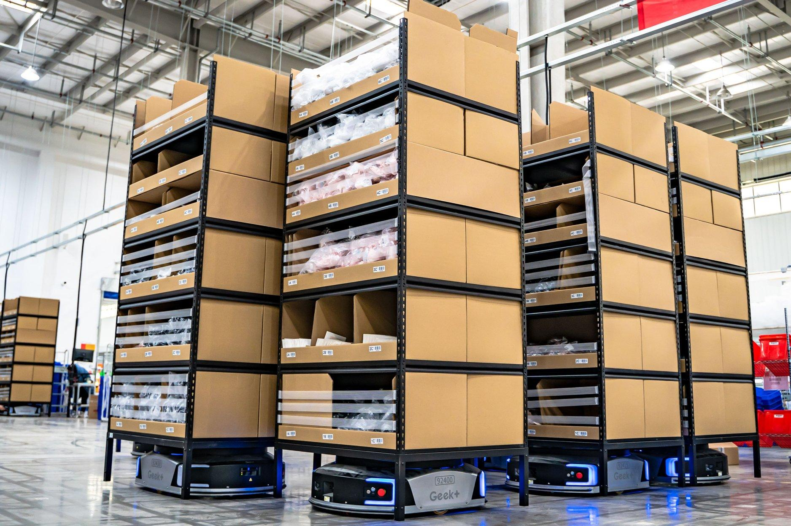

# 第一章：SLAM 是什么？为什么机器人需要 SLAM？

> **课程定位：** 基础概念入门
> **学习目标：** 理解 SLAM 的含义、基本工作流程、必要性及应用场景。
> **图片说明：** 本文已将真实机器人图片、激光扫描示意图、实际建图结果和
> GIF 动图用 Markdown
> 图片语法嵌入。图片来自公开的机器人项目/教学文档，打开文件时需要联网。

---

## 一、什么是 SLAM？

SLAM 是机器人、自动驾驶、无人机等领域的一项核心技术。

**SLAM（Simultaneous Localization and
Mapping）**，中文称为**同时定位与地图构建**。

简单来说，SLAM
就是让机器人在陌生环境中，**一边估计自己的位置，一边构建周围环境的地图**。

### 1. 英文术语解析

  英文           音标（IPA）         中文含义

---

  Simultaneous   /ˌsɪməlˈteɪniəs/    同时发生的
  Localization   /ˌloʊkələˈzeɪʃən/   定位
  Mapping        /ˈmæpɪŋ/            建图、映射

定位不仅是知道机器人位于哪里，还包括判断它朝向哪个方向。在机器人领域，位置与朝向的组合通常称为**位姿（Pose）**。

### 2. 看看 SLAM 系统由什么组成

`<small>`{=html}图：一个激光 SLAM
系统的流程概览。图中包括机器人、位姿图、回环检测和最终地图。来源：Carleton
College 的 LiDAR SLAM 教学项目。`</small>`{=html}

真实机器人使用传感器观察周围环境，再由 SLAM
算法处理观测与运动信息，最终形成计算机能够使用的地图。

- **真实世界：** 机器人所在的房间、墙壁、桌椅等。
- **传感器观测：** 激光雷达或摄像头获得的环境信息。
- **数字地图：** 机器人根据传感器信息构建出来的环境表示。

---

## 二、用一个例子理解 SLAM

假设你把一台扫地机器人放进一个完全陌生的房间。它没有提前获得房间地图，也不知道自己现在处于什么位置。

机器人正在运行建图任务]()

`<small>`{=html}图：机器人在移动过程中运行 SLAM 建图。来源：TurtleBot3
SLAM 文档。`</small>`{=html}

机器人需要回答两个问题。

**问题一：我在哪里？**

它需要判断自己位于房间的什么位置，朝向哪个方向。

**问题二：周围是什么样的？**

它需要逐步了解墙壁、家具、障碍物的分布，建立一张能够描述环境的地图。

但这里出现了一个有趣的难题：

- 没有地图，机器人很难准确判断自己在哪里。
- 不知道自己的位置，又很难准确地把观测到的物体放到地图中。

这就是 SLAM 的核心问题之一。

想象你被带到一个陌生房间里，手里只有一个测距设备。你先测量前方的墙壁，再向前移动，观察侧面的墙壁，最后发现自己又回到了之前经过的位置。你会不断利用新获得的信息，判断自己走到了哪里，并逐渐拼出房间的布局。

机器人所做的事情与此类似，只不过它使用传感器、数学模型和算法来完成这些工作。

**核心认识：定位与建图并不是两个完全独立的任务，它们会相互影响、相互修正。**

---

## 三、SLAM 是怎么工作的？

这一部分先建立整体认识，不深入展开具体的测距公式、坐标变换和地图算法，这些属于后续章节的内容。

SLAM 的基本工作过程可以分为四个环节：

1. **感知环境：** 通过激光雷达、摄像头等传感器获取环境信息。
2. **估计自身位置：**
   结合运动信息和环境观测，估计机器人移动了多少、当前在哪里。
3. **构建环境地图：**
   将传感器观测与位置估计结合起来，逐步形成环境地图。
4. **持续更新与修正：**
   机器人继续移动、获取新观测，并根据新信息修正位置与地图。

这不是一次性执行的四个步骤，而是一个不断循环的过程。

### 动态演示 1：机器人在未知环境中探索与建图

如果上面的 GIF 没有显示，可以[打开原始
GIF](https://www.cs.cmu.edu/~mercator/map5/map.gif)。

**观看时重点观察：**

- 机器人从未知区域开始移动。
- 随着探索进行，地图逐渐出现墙壁和通道。
- 机器人走过的区域越来越多，地图也逐渐完整。

这就是 SLAM
的直观效果：**机器人不是先拿到完整地图再行动，而是在行动过程中逐渐建立地图。**

### 动态演示 2：ROS 机器人边移动边建图

动画]()

观看时重点观察：

- 机器人位置变化时，地图如何逐渐扩展。
- 新的环境观测如何补充地图。
- 地图并不是提前画好的，而是在运行过程中持续更新。

### 动态演示 3：FastSLAM 模拟

GIF]()

这是一个算法模拟示例，不是实际扫地机器人的录像。观看时可以注意不同轨迹之间的差异，理解机器人位置估计为什么可能产生误差，以及算法如何利用观测信息改善估计。

---

## 四、为什么要有 SLAM？

既然机器人可以使用 GPS 定位，也可以提前获得地图，为什么还需要 SLAM？

因为现实环境并不总是具备可靠的 GPS 信号，也不总是有现成、准确的地图。

### 1. 没有可靠定位和地图会怎样？

机器人可能遇到以下困难：

- **不知道自己在哪里：** 移动后无法准确判断当前位置和方向。
- **不了解环境：** 不知道墙壁和障碍物的具体分布。
- **难以自主规划路线：**
  缺少可靠的位置和地图信息，就难以规划从起点到目标点的路线。
- **位置误差逐渐累积：**
  仅依靠车轮转动等信息推算位置时，打滑等因素可能造成误差。

SLAM
能够帮助机器人在缺少可靠外部定位信息的环境中，同时估计自身位置并构建环境地图。

### 2. 为什么不能直接使用 GPS？

GPS 的英文全称是 **Global Positioning System**，即全球定位系统。

  对比               GPS                    SLAM

---

  主要作用           提供地理位置估计       同时估计自身位置并构建地图
  室内环境           通常容易受到信号遮挡   可以利用合适的传感器工作
  地下停车场         通常难以可靠定位       在满足传感器与环境条件时可以工作
  构建周围环境地图   不能直接完成           是 SLAM 的核心任务之一

GPS 和 SLAM 并不互相排斥。实际系统也可以融合
GPS、激光雷达、摄像头等信息，提高定位的准确性与稳定性。

### 3. 为什么不能直接使用现成地图？

提前获得地图确实可以减少建图的工作，但机器人仍然需要知道自己位于地图中的什么位置。

此外，真实环境还可能发生变化，例如家具被移动，或者机器人进入地图未覆盖的区域。

如果已经有准确地图，机器人也可以使用专门的定位算法，而不一定需要完整的
SLAM 系统。

因此，SLAM
尤其适合未知环境探索、实时建图，以及缺少可靠外部定位信息的场景。

---

## 五、SLAM 有哪些主要类型？

### 这部分见同文件夹下另一个md文件,C:\Users\ROG\OneDrive\Desktop\slam\1\SLAM主要种类_图片与GIF完整版.md

---

## 六、SLAM 与自主导航有什么区别？

这是学习机器人时必须区分的几个概念。

  技术                         主要解决的问题

---

  SLAM                         我在哪里？周围环境是什么样？
  路径规划（Path Planning）    我应该走哪条路？
  运动控制（Motion Control）   怎样控制机器人按照路线移动？
  避障（Obstacle Avoidance）   怎样避开障碍物并安全通行？

举个例子：机器人需要从客厅移动到卧室。

1. SLAM 负责提供位置估计和地图信息。
2. 路径规划根据地图和目标位置计算路线。
3. 运动控制负责控制电机，让机器人沿着路线移动。
4. 避障功能负责处理行进过程中遇到的障碍物。

**SLAM 是自主导航的重要基础，但 SLAM 本身并不等于完整的自主导航系统。**

即使机器人能够完成建图，也不意味着它一定能自动选择目标、规划路线或保证绝不碰撞。

---

## 七、SLAM 有哪些实际应用？

### 1. 扫地机器人

建立室内地图，辅助清扫路线规划与返回充电座。

### 2. 仓储物流机器人

在仓库内定位、建图，支持自主搬运。

### 3. 无人机

在 GPS 信号较弱的环境中辅助定位和探索。

### 4. 自动驾驶汽车

辅助车辆定位与环境建图，是相关感知与定位技术的一部分。

---

## 八、总结与思考

本章需要掌握以下内容：

1. **SLAM 是什么？** 同时定位与地图构建。
2. **为什么定位和建图相互依赖？**
   因为机器人需要位置信息来构建地图，也需要地图信息帮助判断自身位置。
3. **SLAM 如何工作？**
   通过传感器观测、位置估计、地图构建和持续修正，不断认识周围环境。
4. **为什么需要 SLAM？** 因为 GPS
   和预先构建的地图无法在所有环境中满足机器人的定位与建图需求。
5. **SLAM 有哪些类型？** 激光 SLAM、视觉 SLAM、视觉惯性
   SLAM、多传感器融合 SLAM。
6. **SLAM 与自主导航有什么区别？** SLAM
   提供定位和地图信息，自主导航还需要路径规划、运动控制和避障等功能。
