# SLAM 的主要种类与真实建图演示

> 本文按**传感器类型**介绍 SLAM 的主要大类，并配有真实项目图片和 GIF 动态演示。
>
> **阅读提示：** 图片和 GIF 通过 Markdown 图片语法嵌入，打开文件时需要联网。若某个 GIF 在预览器中只显示静态画面，可以点击图片下方的“原始动图”链接查看。

## 一、SLAM 的主要大类

SLAM（Simultaneous Localization and Mapping，同步定位与建图）是指机器人在估计自身位置的同时，逐步构建周围环境地图。

按照主要使用的传感器，可以先分成三大主流路线，以及两类面向特殊环境的路线：

1. **激光 SLAM（LiDAR SLAM）**：使用激光雷达测量环境距离。
2. **视觉 SLAM（Visual SLAM）**：使用摄像头获取图像。
3. **多传感器融合 SLAM（Multi-Sensor Fusion SLAM）**：结合激光雷达、相机、IMU 等传感器。
4. **毫米波雷达 SLAM（Radar SLAM）**：利用雷达反射信息定位与建图。
5. **声呐 SLAM（Sonar SLAM）**：利用声波回波进行水下定位与建图。

```text
SLAM
├── 激光 SLAM
├── 视觉 SLAM
├── 多传感器融合 SLAM
├── 毫米波雷达 SLAM
└── 声呐 SLAM
```

> 说明：这是一种便于入门理解的分类方式，并非唯一分类标准。比如视觉惯性 SLAM 本身就是视觉与 IMU 的融合；LIO-SAM 是激光雷达与 IMU 融合系统。

---

## 二、激光 SLAM（LiDAR SLAM）

**核心原理：** 利用激光雷达测量周围物体的距离，再将机器人在不同位置获取的扫描结果拼接起来，逐步形成地图。

### 1. 二维激光 SLAM：地图逐步生成

下面的 GIF 展示了二维激光建图的动态过程。观察机器人移动时，墙壁和障碍物如何逐步出现在地图中。

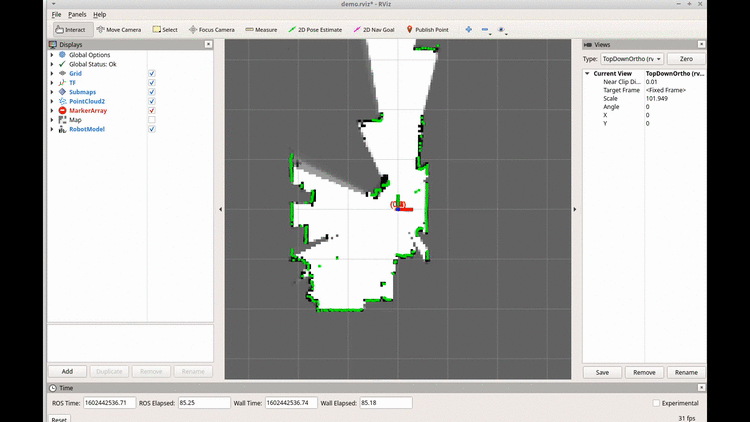

[如果动图未显示，点击查看原始 GIF](https://miro.medium.com/v2/resize:fit:1400/1%2A8ImKqBVghzGgsvGWvz6foA.gif)

### 2. 二维激光地图的实际效果

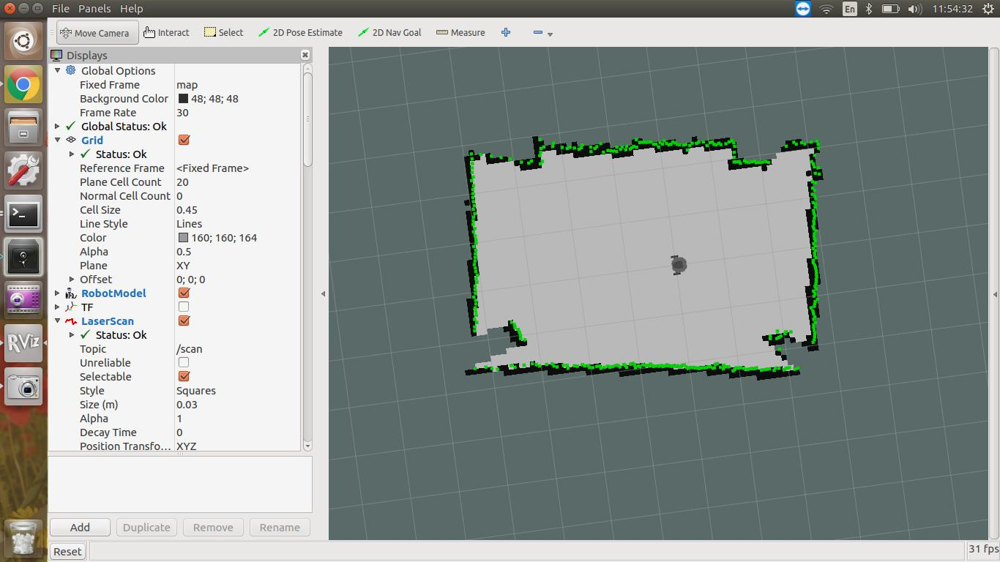
*图中灰白区域表示已探索的可通行空间，深色区域表示障碍或未知区域；不同颜色的扫描点用于显示当前激光观测。*

### 3. 三维激光 SLAM：点云地图

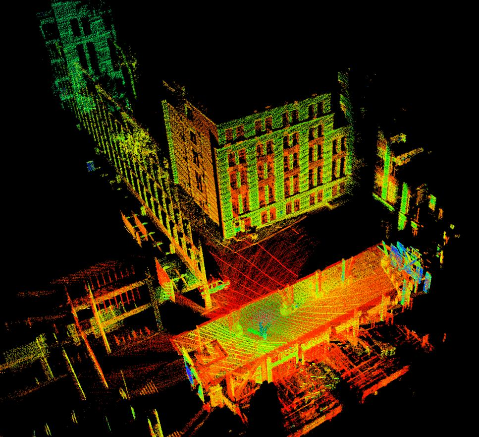

三维激光 SLAM 可以恢复建筑、道路和周围物体的立体几何结构，常见结果是三维点云地图。

**常见算法/系统：** Gmapping、Cartographer、LOAM。LIO-SAM 还会融合 IMU 信息，属于激光—惯性融合系统。

---

## 三、视觉 SLAM（Visual SLAM）

**核心原理：** 利用摄像头连续拍摄的图像，估计相机的运动，并恢复周围环境的三维结构。

### 1. ORB-SLAM3 的真实运行效果

![ORB-SLAM3 三维地图与相机轨迹]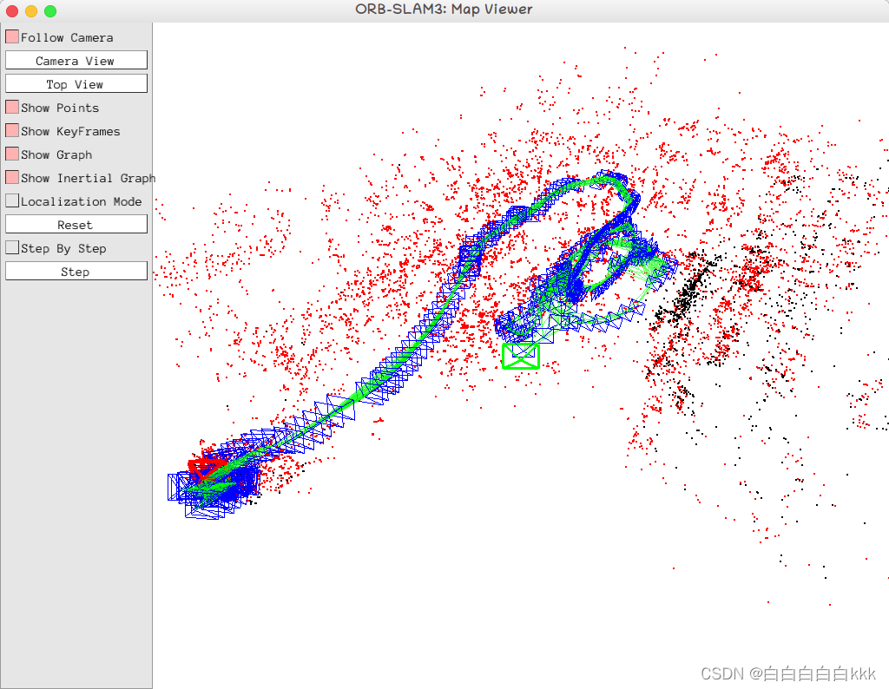

图中的红色点表示三维地图点，蓝色/绿色线框与轨迹表示相机关键帧及运动路径。这是**静态截图**，用于替换先前无法正常显示的 ORB-SLAM3 GIF。

### 2. 相机图像中的特征点跟踪

![ORB-SLAM3 当前相机画面与特征点]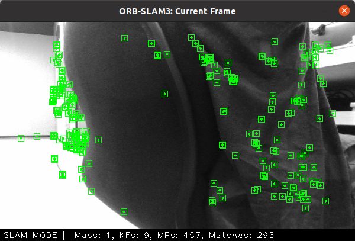
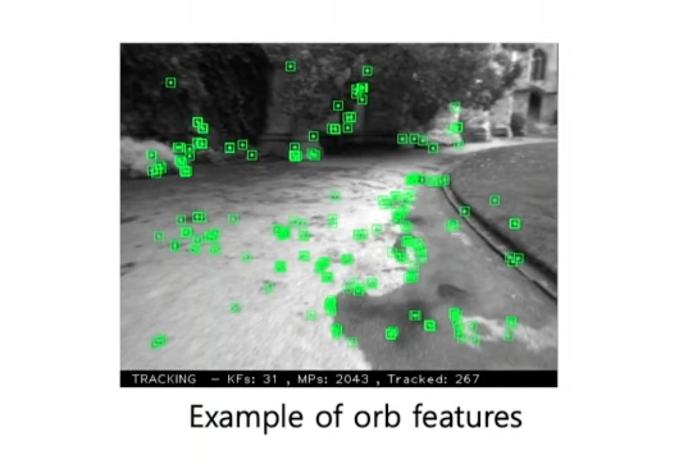
图像中的绿色方框标出系统正在跟踪的视觉特征。系统会结合连续画面中这些特征的位置变化，估计相机运动。

### 3. 视觉 SLAM 常见的相机形式

#### 单目 SLAM（Monocular）


只使用一个摄像头。设备简单、成本较低，但单目系统通常不能仅凭图像直接确定真实世界的绝对尺度。

#### 双目 SLAM（Stereo）

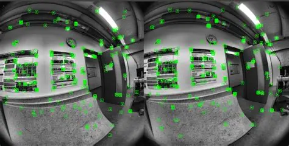
使用两个相机从不同位置观察同一场景，通过左右图像的视差估计深度。

#### RGB-D SLAM

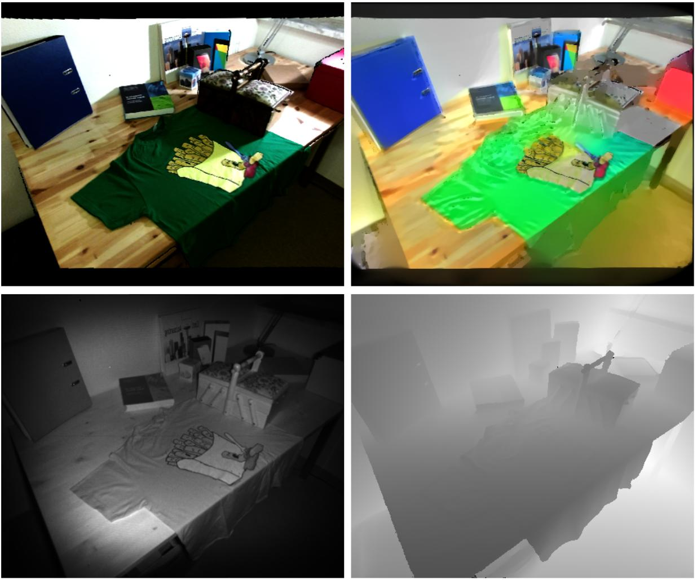

RGB-D 系统同时使用彩色图像（RGB）和深度信息（Depth），可以直接利用深度测量构建三维地图。

**常见算法/系统：** ORB-SLAM3、LSD-SLAM。RTAB-Map 也支持多种视觉与 RGB-D 建图配置。

> 注意：单目、双目和 RGB-D 是按相机/深度获取方式划分；特征点法、直接法则是按图像处理方法划分，两者不是同一层级的分类。

---

## 四、多传感器融合 SLAM（Multi-Sensor Fusion SLAM）

**核心原理：** 将不同传感器的信息结合起来，利用它们的互补优势，提高定位和建图的稳定性。

### 1. LVI-SAM：激光 + 视觉 + IMU

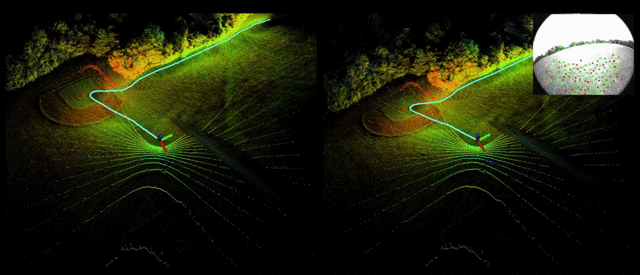
三类传感器的分工：

- **激光雷达：** 测量距离，提供环境几何结构。
- **摄像头：** 提供颜色、纹理和视觉特征。
- **IMU（惯性测量单元）：** 测量角速度和加速度，辅助估计运动。

### 2. 多传感器 SLAM 的可视化界面

![多传感器融合 SLAM 可视化界面]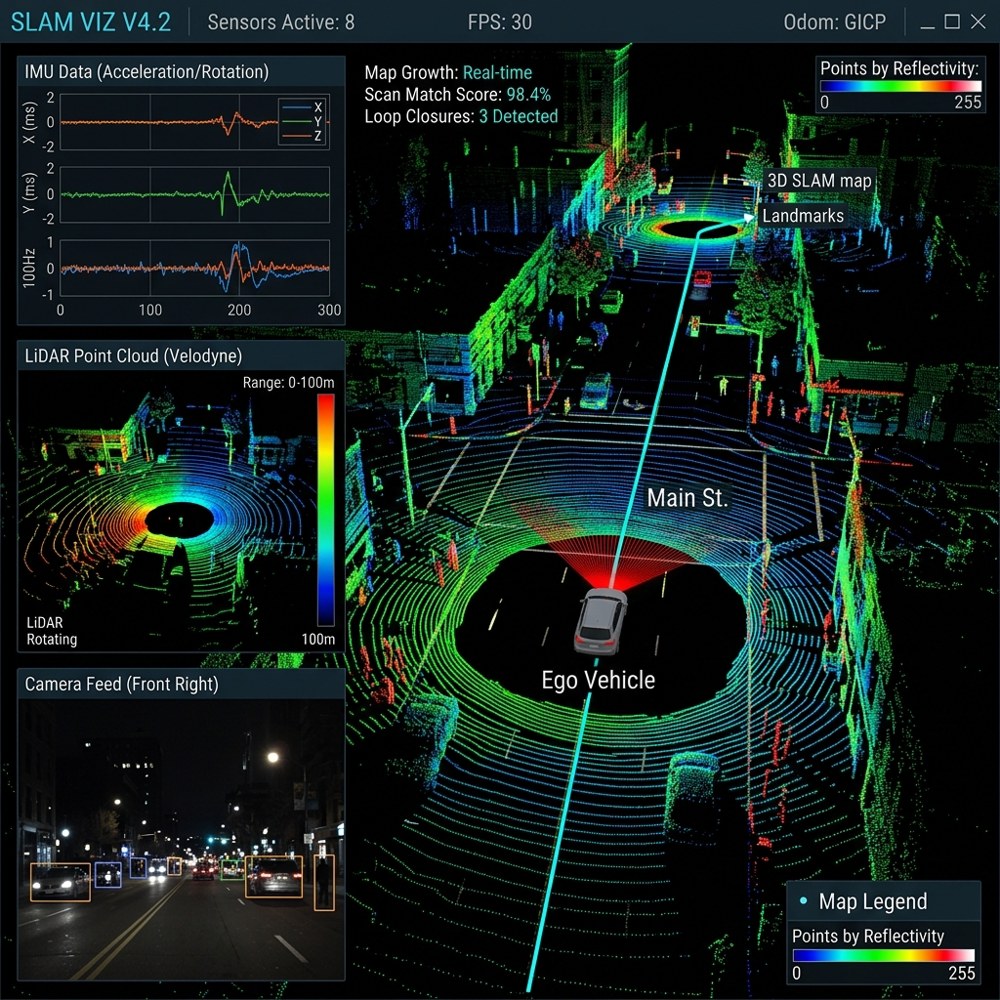

该类系统可以在同一个界面中查看激光点云、相机画面、惯性信息和地图结果。

### 3. LIO-SAM：激光雷达 + IMU

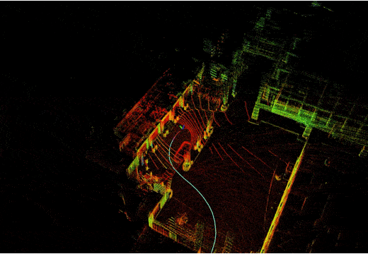

[如果动图未显示，点击查看 LIO-SAM 官方 GIF](https://raw.githubusercontent.com/TixiaoShan/LIO-SAM/master/config/doc/demo.gif)
[项目主页：LIO-SAM](https://github.com/TixiaoShan/LIO-SAM)

**重要区别：** LVI-SAM 融合激光、视觉与惯性信息；LIO-SAM 主要融合激光雷达和 IMU，不是完整的视觉融合系统。

---

## 五、毫米波雷达 SLAM（Radar SLAM）

**核心原理：** 利用毫米波等雷达发射和接收的反射信号，估计自身运动并建立环境特征地图。

![高分辨率汽车雷达 SLAM 的定位与建图结果]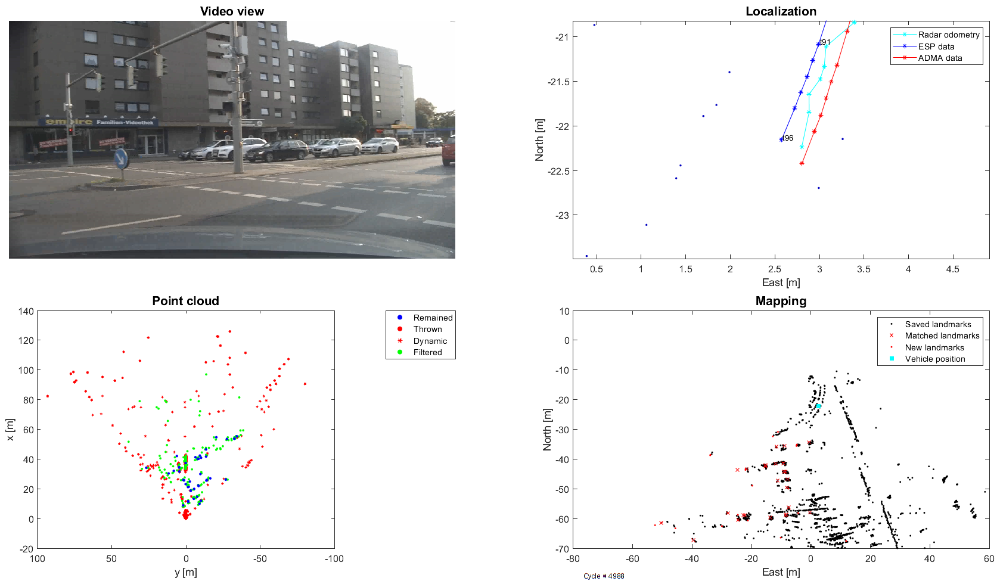
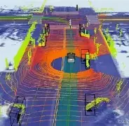

雷达在夜间和部分恶劣天气中仍然可以工作，因此适合研究复杂天气下的车辆定位。不过，雷达数据可能存在反射噪声、虚假目标和空间分辨率有限等问题。

[图片来源：斯图加特大学高分辨率汽车雷达定位与建图研究](https://www.ifp.uni-stuttgart.de/lehre/masterarbeiten/572-jia/)

---

## 六、声呐 SLAM（Sonar SLAM）

**核心原理：** 利用声波在水中的传播与回波信息，推断周围结构和水下机器人位置。

### 1. 水下地形深度地图

![自主水下机器人海底地形测绘结果]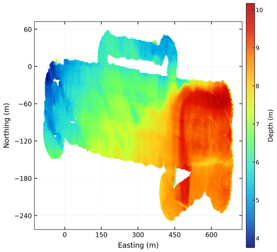

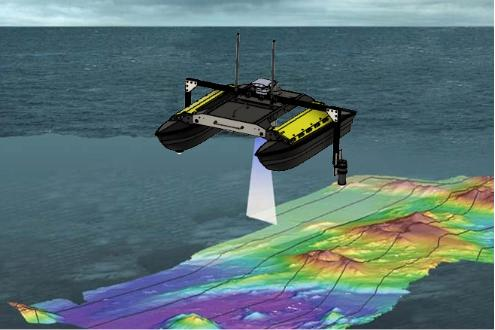
颜色表示不同位置的水深或地形高度。声呐可以帮助水下机器人在 GPS 信号无法正常使用的环境中进行地形测绘。

### 2. 侧扫声呐图像

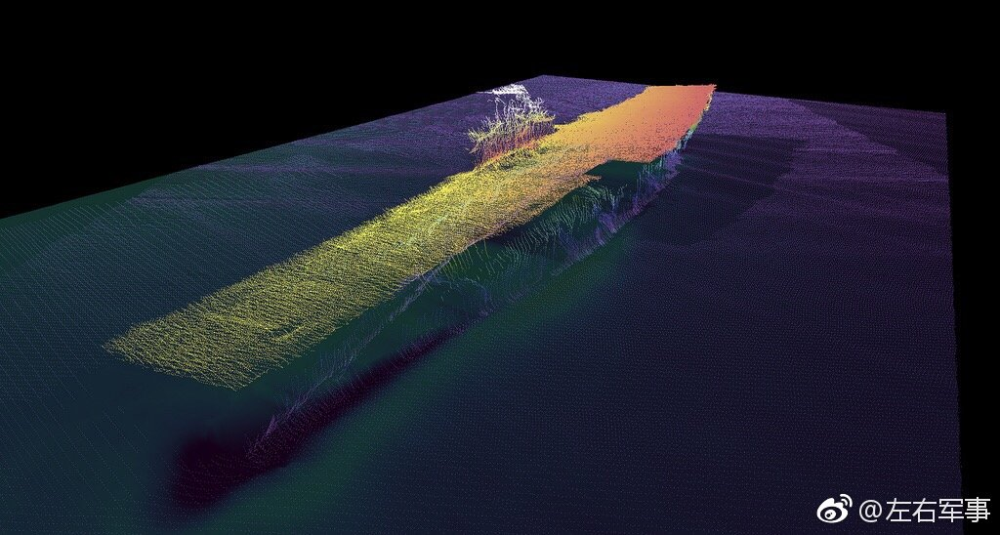![侧扫声呐获取的海底沉船图像]

声呐也可以显示海底物体的回波纹理，例如沉船和海底障碍物，常用于水下勘测与设施检查。

---

## 七、五大类对比总结

| SLAM 类型         | 主要传感器             | 常见地图结果             | 典型应用                 |
| ----------------- | ---------------------- | ------------------------ | ------------------------ |
| 激光 SLAM         | 激光雷达               | 二维栅格、三维点云       | 室内机器人、移动机器人   |
| 视觉 SLAM         | 摄像头                 | 稀疏地图、三维重建       | AR、无人机、机器人       |
| 多传感器融合 SLAM | 激光雷达、相机、IMU 等 | 点云、轨迹、彩色地图     | 自动驾驶、复杂环境机器人 |
| 雷达 SLAM         | 毫米波等雷达           | 雷达反射特征地图         | 全天候定位研究           |
| 声呐 SLAM         | 声呐                   | 水下特征地图、海底地形图 | 水下机器人、海底测绘     |
