# SLAM 第二章：机器人怎样把观测变成地图？

> 图文教学稿｜真实技术图片｜GIF 动态演示｜激光测量交互案例
> 本文件优先采用真实研究、开源项目和机器人软件截图。网络图片与 GIF 通过原始图片链接显示，阅读时需要联网。体素分辨率对比图与激光测量交互网页随资料包提供。

## 本章学习目标

学完本章，应能解释：

1. 机器人怎样把传感器测量转换成地图中的观测点。
2. 二维栅格、三维点云、体素、特征点、拓扑、语义、高程、Mesh 与高斯泼溅有什么区别。
3. 二维激光、三维激光、单目视觉、双目视觉、RGB-D 和视觉惯性 SLAM 各适合什么任务。
4. 地图为什么会变形、跟踪为什么会丢失，以及地图在 RViz 中消失时应该怎样排查。

---

# 第一部分：机器人怎样把观测变成地图？

## 1. 从激光测量开始：机器人先测到距离

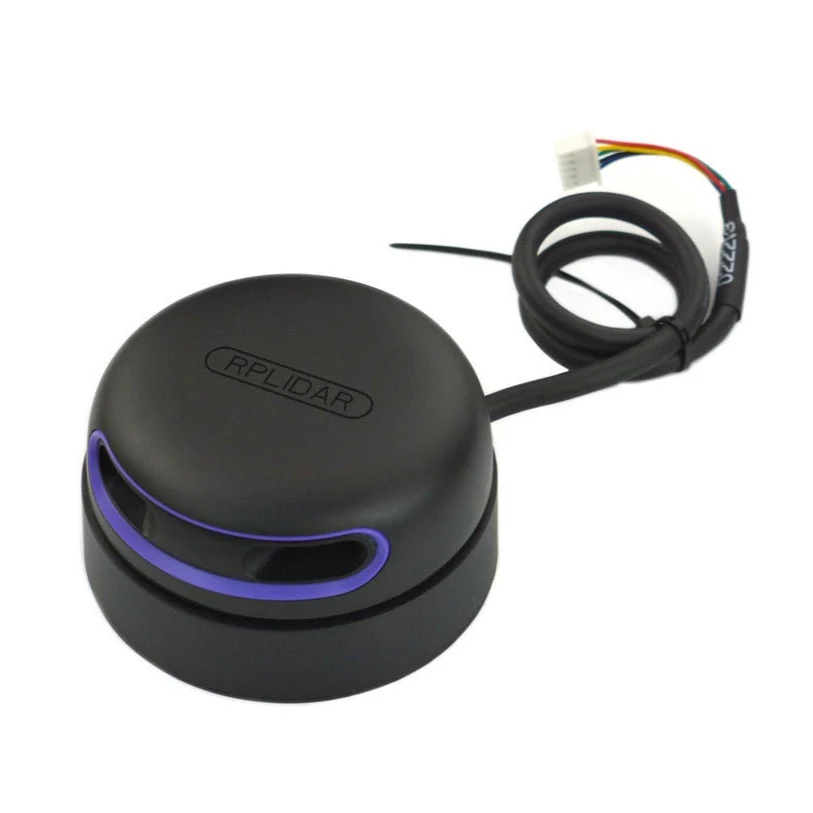
*图 1：二维激光雷达实物。它通过测量周围物体的距离，获取环境信息。图片来源：[RPLIDAR A2M12 产品页](https://www.voltaat.com/products/rplidar-a2m12-360-lidar-laser-scanner-12m-range)。*

假设机器人测到前方某个方向的墙壁距离自己 3 米。仅知道距离还不够，还需要知道测量方向，才能确定观测点相对于机器人的坐标。

如果测量距离为 \(r\)，测量角度为 \(\alpha\)，以机器人为原点，且传感器坐标轴与机器人坐标轴对齐，那么观测点坐标为：

\[
x=r\cos\alpha,\qquad y=r\sin\alpha
\]

例如，\(r=3\) 米、\(\alpha=45^\circ\)：

\[
x=3\cos45^\circ\approx2.12,\qquad
y=3\sin45^\circ\approx2.12
\]

因此，这个观测点的坐标约为 \((2.12,2.12)\) 米。

### 交互案例：改变角度和距离，看看坐标怎样变化

这是本章保留的交互式学习案例。打开同一资料包里的 [激光测量坐标转换交互演示 HTML](SLAM第二章_激光测量交互演示.html)，拖动角度和距离滑块，观察观测点的实时变化。

交互案例中，蓝点代表机器人，橙点代表观测点：

- 改变角度，观测点会沿不同方向移动。
- 增大距离，观测点会离机器人更远。
- 每次测量可以得到一个坐标点；多次扫描会产生大量观测点。

> 注意：这是简化示例。真实机器人还需要考虑传感器相对于机器人底盘的安装偏移，以及机器人每一时刻的位置与朝向。

## 2. 大量观测点怎样形成地图？

![LIO-SAM 三维点云示例]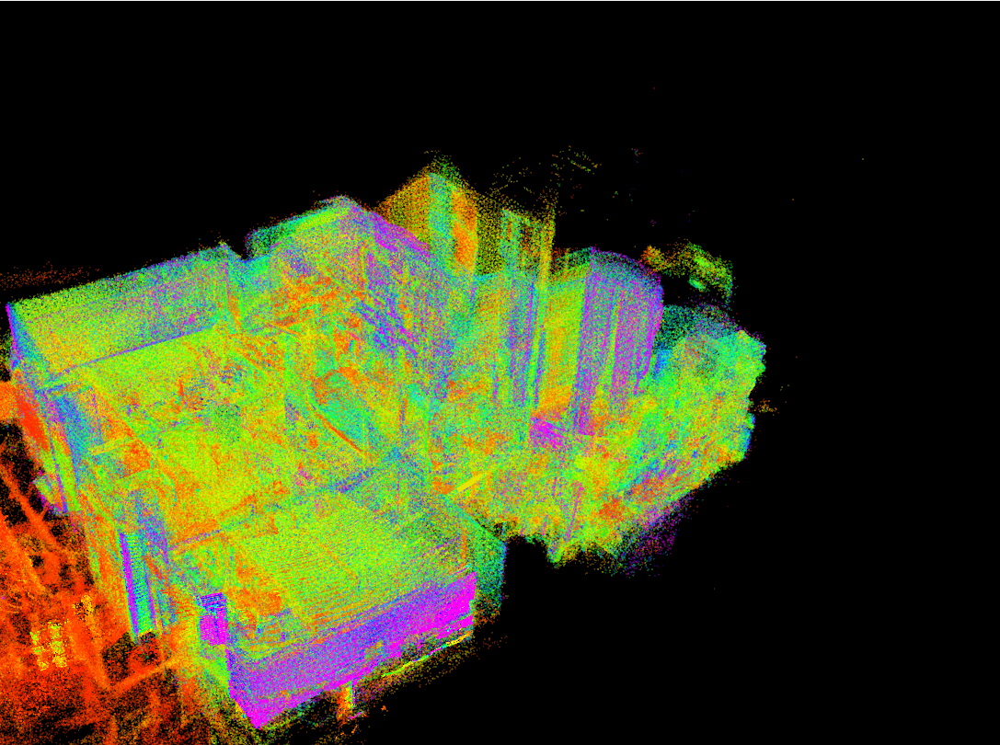

*图 3：室内建筑的三维 LiDAR 点云。墙面、地面和结构边界由大量空间点组成。来源：[LIO-SAM 项目讨论](https://github.com/TixiaoShan/LIO-SAM/issues/268)。*

单独一个观测点，只能告诉机器人某个方向上测到了一个位置；大量点组合起来，才能逐步表现墙壁、走廊和障碍物的轮廓。

但机器人移动后，新观测应该放在地图的什么位置？机器人需要估计自己每一时刻的位置和朝向，再把新观测转换到统一的地图坐标系中。如果位置估计不准确，不同时间的观测就可能错位。

因此，SLAM 不只是把传感器测量结果画出来，还需要同时估计机器人位姿、整合地图，并不断修正误差。

### GIF：机器人在未知环境中逐渐探索

观察机器人探索区域扩大时，地图如何逐渐形成。机器人不是一开始就拥有完整地图，而是在运动和观测过程中逐步认识环境。

### GIF：SLAM Toolbox 实际室内建图

观察扫描数据如何逐步形成地图；不同时间的观测需要对齐；机器人重新到达曾经访问过的区域时，回环检测和位姿图优化还可能修正之前的估计。

---

# 第二部分：地图有哪些类型？

> 先区分两个问题：**地图的表示形式**回答“地图长什么样”，**SLAM 技术路线**回答“机器人通过什么传感器和方法来定位、建图”。二者有关联，但不是一回事。

## 1. 二维栅格地图（2D Occupancy Grid Map）

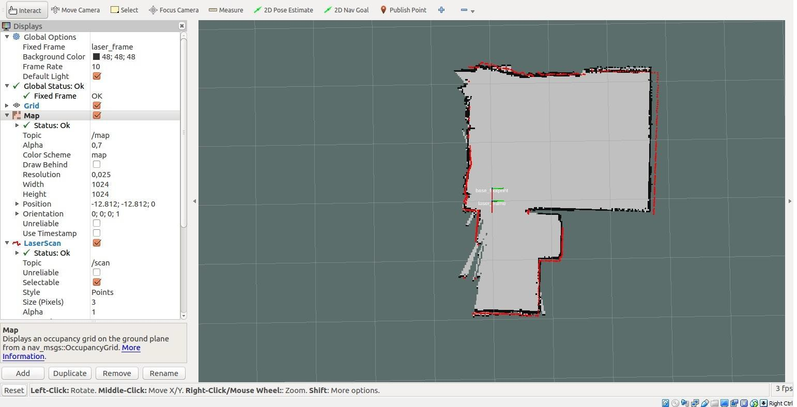

*图 6：RViz 中的二维占据栅格地图。来源：[SICK Scan 文档](https://docs.ros.org/en/jazzy/p/sick_scan_xd/)。*

把地面想象成由许多小方格组成的棋盘。机器人根据激光测量，判断每个格子是否被障碍物占据。

- **已占据：** 例如墙壁或障碍物。
- **空闲：** 机器人已经确认可通过的区域。
- **未知：** 机器人还没有足够信息判断的区域。

这种地图结构简单、计算负担相对较小，适合许多室内移动机器人进行定位和导航。

局限是二维地图主要描述一个平面，难以完整表达桌面高度、悬空障碍物和复杂三维结构。

## 2. 三维点云地图（3D Point Cloud Map）

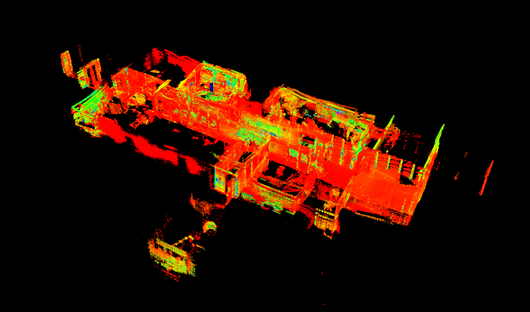
*图 7：真实研究项目中的三维点云。来源：[LIO-SAM](https://github.com/TixiaoShan/LIO-SAM/issues/268)。*

三维点云由大量具有三维坐标的离散点组成：

\[
P_i=(x_i,y_i,z_i)
\]

其中，\(x_i,y_i,z_i\) 分别表示第 \(i\) 个点的三维坐标。点云可以描述墙壁、地面、桌面和其他物体的空间轮廓。

**局限：** 点云可能非常庞大，需要进一步处理；点云本身也不一定直接包含“哪里可以通行”这样的导航信息。

> 识别图片时要注意：点云应该表现为离散的空间点。仅仅呈现一幅逼真的三维房间渲染图，并不能证明它就是点云。

## 3. 三维体素地图（3D Voxel Map）

*图 8：三维占据体素示例。来源：[ROS Answers — OctoMap free-space visualization](https://answers.ros.org/question/411664/)。*

二维栅格把平面切成小方格；三维体素把空间切成小立方体。

- **Pixel** /ˈpɪksəl/：像素，二维图像中的基本单元。
- **Voxel** /ˈvɒksəl/：体素，三维空间中的基本单元。

每个体素可以记录该位置是否被占据、是否空闲或是否未知。OctoMap 使用八叉树组织三维占据地图，以提高空间存储效率。

### 体素可以有多精细？

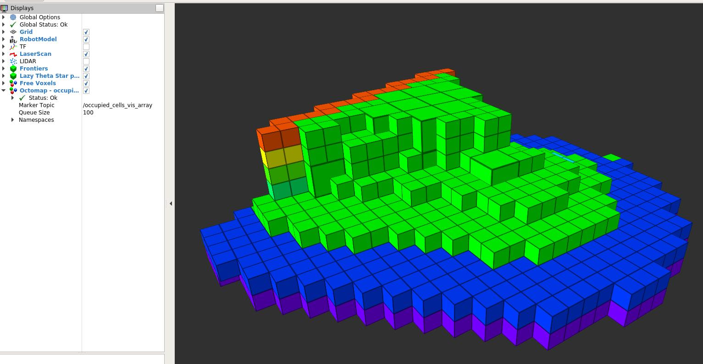

*图 9：粗分辨率体素示意图。较大的立方体更容易忽略细小结构。此图为教学示意，不是实测地图。*

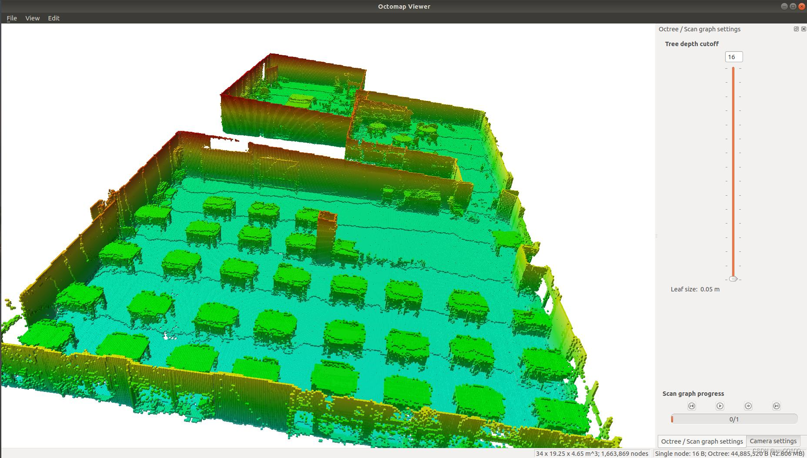

*图 10：细分辨率体素示意图。更小的单元可以表达更多细节，但存储和计算成本通常更高。此图为教学示意，不是实测地图。*

假设在一个固定大小的三维区域内，将每个方向的体素边长缩小一半，那么每个方向可以容纳原来两倍的体素，体素总数理论上会变成原来的：

\[
2\times2\times2=8\text{ 倍}
\]

因此，体素并不是越小越好，而是要在地图精度、计算能力和存储成本之间取得平衡。

### GIF：三维体素地图逐渐增长

![OctoMap 三维体素增长 GIF]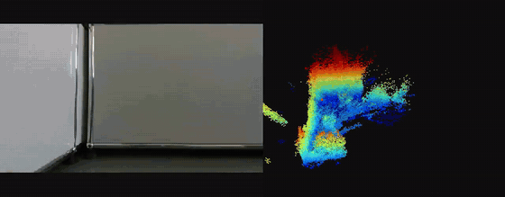

*图 11：TurtleBot3、深度相机和 OctoMap 项目的三维占据地图增长演示。来源：[TurtleBot3 OctoMap Guide](https://github.com/prakash-aryan/tbot3-octomap-guide)。*

观察深度观测如何逐步转换为三维占据地图。新数据到来时，地图会持续更新，而不是在开始时就自动拥有完整环境。

## 4. 特征点地图（Feature Map）

*图 12：ORB-SLAM3 地图查看器示例。红点表示地图点，蓝色相机框表示关键帧，绿色轨迹表示估计的运动路径。来源：[ORB-SLAM3 运行示例](https://blog.csdn.net/qq_45306739/article/details/130624822)。*

摄像头拍摄环境时，算法可以寻找墙角、门框和明显纹理等容易识别的位置。如果机器人移动后仍然能在新图像中找到这些特征，就可以利用它们估计摄像头运动。

优点是地图可以比较紧凑，适合视觉定位和跟踪。局限是低照度、运动模糊和环境缺少纹理时，特征提取与匹配可能变得困难。

特征点地图主要服务于定位和视觉跟踪，不一定直接作为完整的避障地图。

## 5. 拓扑地图（Topological Map）

![拓扑地图示例]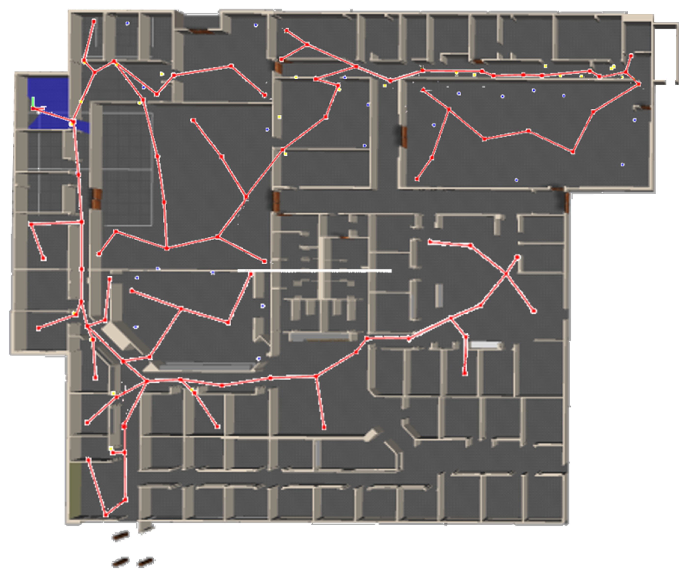
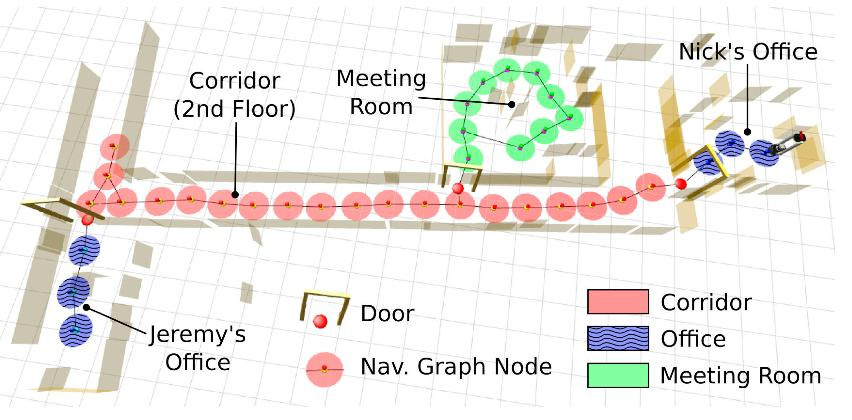

*图 13：室内拓扑建图研究示例。节点与连接关系用于表达地点之间的连通性。来源：[Topological Frontier-Based Exploration and Map-Building](https://www.mdpi.com/1424-8220/19/20/4595)。*

拓扑地图重点记录地点之间的连接关系，而不一定记录每个位置的精确几何形状。例如，把客厅、走廊和卧室抽象成节点，再用连线表示它们之间是否连通。

它适合高层路线规划，但精确避障通常还需要几何地图或局部障碍物信息。

## 6. 语义地图（Semantic Map）

*图 14：室内语义地图研究示例，不同颜色标注床、沙发、厨具等物体类别。来源：[Object-Semantic Grid Mapping for Domestic Robot Navigation](https://www.mdpi.com/2076-3417/10/17/5782)。*

普通几何地图告诉机器人“这里有一个障碍物”，语义地图则进一步告诉机器人“这里是一张桌子”或者“那里是一扇门”。

这让机器人不仅能表示物体在哪里，还能进一步理解物体是什么。

## 7. 高程地图（Elevation Map）

*图 15：机器人地形高程建图研究示例，颜色表示不同位置的高度和不确定性。来源：[Probabilistic Terrain Mapping for Mobile Robots](https://www.researchgate.net/publication/325918227_Probabilistic_Terrain_Mapping_for_Mobile_Robots_With_Uncertain_Localization)。*

高程地图记录地面不同位置的高度，适合分析台阶、斜坡和崎岖地形。对于需要判断地面是否平整、能否安全通过的机器人尤其有用。

## 8. 三维网格地图（Mesh Map）

![Open3D 三维表面网格重建]
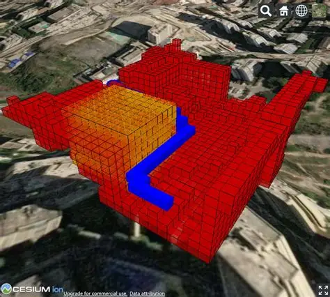
*图 16：Open3D 场景重建得到的三维表面。来源：[Open3D — Integrate Scene](https://www.open3d.org/docs/latest/tutorial/reconstruction_system/integrate_scene.html)。*

网格地图通过相互连接的三角形等多边形构成物体表面，还可以进一步添加颜色和纹理。它适合三维重建、表面分析和可视化，但表面网格本身不一定包含机器人导航所需的自由空间信息。

## 9. 高斯泼溅（3D Gaussian Splatting）

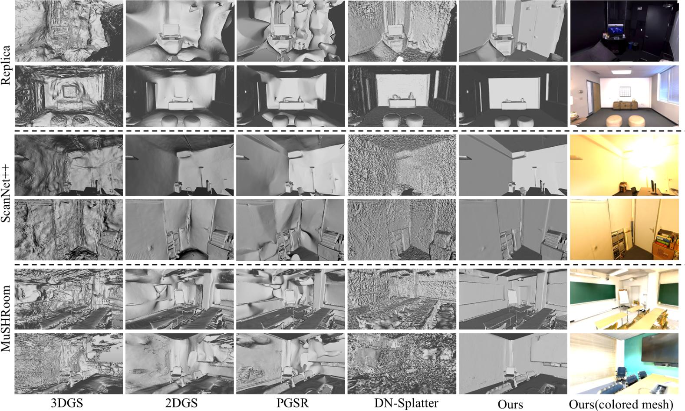

*图 17：3D Gaussian Splatting 的场景重建示例。来源：[Graphdeco-Inria 官方项目](https://github.com/graphdeco-inria/gaussian-splatting)。*

高斯泼溅使用大量具有位置、形状、方向、颜色和不透明度等属性的三维高斯基元表示场景，再通过渲染生成逼真的视图。

它与普通点云和三角网格不是同一种表示方式。**画面看起来像真实房间，不代表它就是点云。** 高斯泼溅更偏向高质量场景表示与渲染；点云更直接地表达离散三维测量；网格则明确描述连接起来的表面。

### 地图类型对照表

| 地图类型   | 核心记录内容         | 典型用途       |
| ---------- | -------------------- | -------------- |
| 二维栅格   | 平面区域的占据状态   | 室内导航       |
| 三维点云   | 离散三维坐标点       | 几何重建与定位 |
| 三维体素   | 空间单元的占据状态   | 三维避障与探索 |
| 特征点地图 | 可识别的视觉特征     | 视觉定位       |
| 拓扑地图   | 地点与连接关系       | 高层路线规划   |
| 语义地图   | 几何信息与物体类别   | 场景理解       |
| 高程地图   | 地面高度变化         | 地形分析       |
| Mesh       | 相互连接的表面       | 三维表面重建   |
| 高斯泼溅   | 三维高斯基元及其外观 | 高质量场景渲染 |

---

# 第三部分：SLAM 有哪些技术路线？怎样选择？
上一章slam分类讲过了
### 六种路线如何选择？

| 技术路线 | 主要优势           | 主要局限           | 常见场景         |
| -------- | ------------------ | ------------------ | ---------------- |
| 二维激光 | 成熟、计算负担较小 | 高度信息有限       | 室内平面导航     |
| 三维激光 | 三维几何信息丰富   | 成本与计算开销较高 | 复杂立体环境     |
| 单目视觉 | 摄像头成本较低     | 绝对尺度不确定     | 视觉定位         |
| 双目视觉 | 可利用视差恢复深度 | 依赖标定与图像匹配 | 三维视觉定位     |
| RGB-D    | 同时获得彩色和深度 | 深度范围受设备限制 | 室内三维建图     |
| 视觉惯性 | 视觉与惯性信息互补 | 标定和同步要求较高 | 无人机、移动设备 |

> 以上是入门阶段的初步选型建议，不意味着某种任务只能使用一种方案。真实工程还要综合考虑定位精度、实时性、成本、计算能力与环境条件。

---

# 第四部分：为什么 SLAM 地图会变形，甚至突然消失？
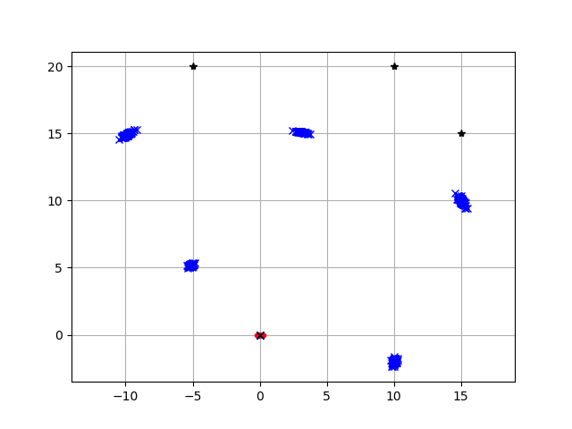

## 1. 累计误差与回环检测

![回环检测修正地图漂移示例]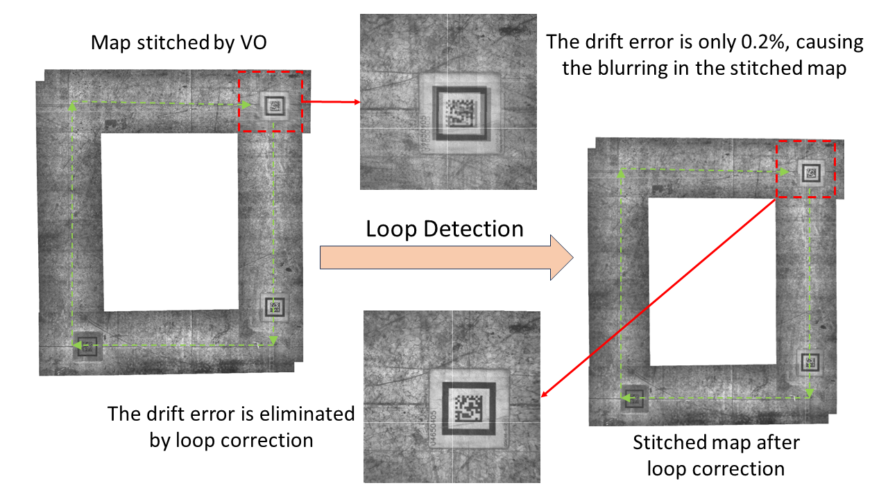

*图 24：回环检测与地图修正示例。图中对比了累计漂移和回环修正后的地图。来源：[GroundSLAM 研究项目](https://sairlab.org/groundslam/)。*

想象机器人绕着房间走了一圈，最后回到起点附近。但由于每一步的位置估计都有一点误差，系统可能认为终点和起点并不重合。

这些误差逐渐累积，就可能造成地图漂移、拉伸或重影。

**回环检测（Loop Closure）** 是指机器人识别出自己重新到达曾经访问过的区域，并利用这一信息优化轨迹、减少累计误差。如果回环匹配错误，也可能造成严重的地图变形。

## 2. 哪些环境容易让 SLAM 出现问题？

### 低纹理环境

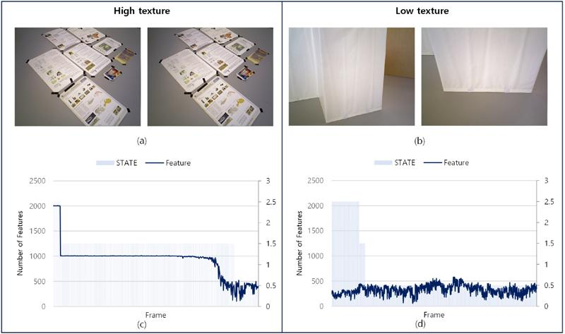

*图 25：低纹理场景下的视觉特征与跟踪表现。来源：[韩国机器人学会期刊研究](https://jkros.org/_PR/view/?aidx=46117&bidx=4174)。*

大面积白墙、地面和缺少明显纹理的表面，会让视觉系统难以找到稳定特征。

### 运动模糊

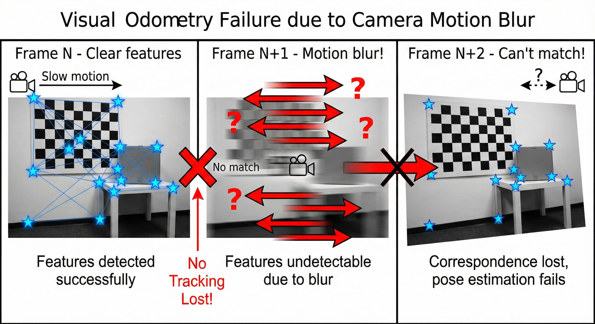

*图 26：相机运动模糊导致特征难以检测与匹配的示例。来源：[Physical AI Laboratory](https://myidentity.github.io/physical-ai-lab/posts/2025-12-17-workshop4-exercises-part2/)。*

摄像头快速转动或移动过快时，图像可能模糊，导致连续帧之间的特征匹配失败。

### 玻璃与反光表面

*图 27：LiDAR 扫描透明与反光表面的示例。来源：[LiDAR 检测限制介绍](https://openelab.io/blogs/learn/centauri-carbon-2-error-1242-1243-1263-fix-guide)。*

反射可能导致部分激光测距异常，视觉系统也可能受到反射图案干扰。

### 动态物体

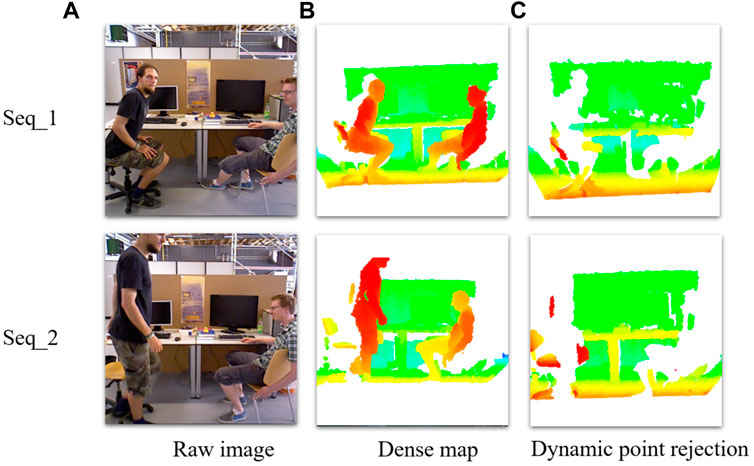
*图 28：动态场景中对人形动态点进行处理的研究示例。来源：[OC-SLAM: Steadily Tracking and Mapping in Dynamic Environments](https://www.frontiersin.org/journals/energy-research/articles/10.3389/fenrg.2021.803631/full)。*

移动的人、椅子或其他物体可能干扰静态环境的匹配与地图更新。

不同传感器的弱点并不完全相同。例如，普通摄像头在黑暗中可能无法获得有效图像；激光雷达虽然能够主动测距，但也会受到反射材质、测量范围和环境条件影响。多传感器融合可以弥补部分不足，但不能保证所有场景下都不出错。

### 地图变形的常见原因

| 影响因素     | 原因                         | 可能出现的现象     |
| ------------ | ---------------------------- | ------------------ |
| 里程计误差   | 轮胎打滑、运动参数不准确     | 地图漂移、拉伸     |
| 传感器噪声   | 测距或成像存在误差           | 墙壁变厚、边缘模糊 |
| 时间不同步   | 位姿与观测的时间不匹配       | 地图错位、重影     |
| 标定错误     | 传感器安装位置或朝向参数不准 | 地图倾斜、扭曲     |
| 扫描匹配失败 | 不同时间的观测未正确对齐     | 局部偏移           |
| 回环检测失败 | 未识别出曾经到过的位置       | 累计误差难以修正   |
| 错误回环匹配 | 将不同地点误认为同一地点     | 地图严重变形       |

## 3. 地图为什么会突然消失？
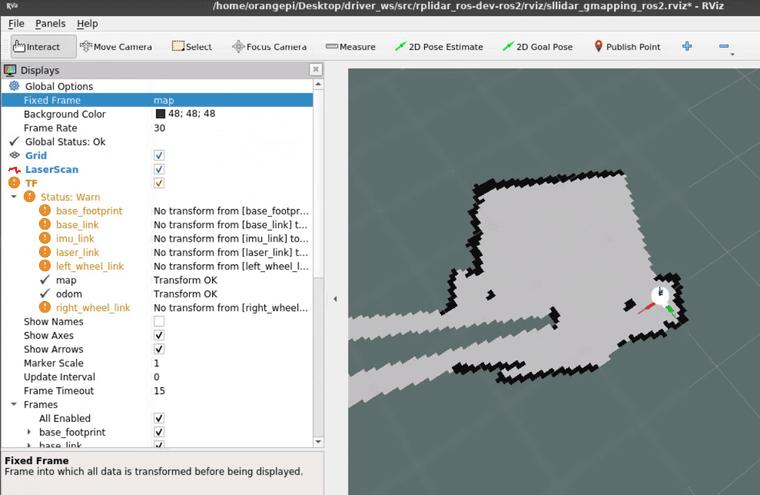

*图 29：RViz 地图显示示例。可视化工具显示异常，不一定代表 SLAM 内部地图数据已经丢失。来源：[SICK Scan 文档](https://docs.ros.org/en/jazzy/p/sick_scan_xd/)。*

机器人已经建好了地图，但打开 RViz2 却看不到了，不一定代表地图数据已经丢失。

| 现象               | 可能原因                         |
| ------------------ | -------------------------------- |
| 视觉地图停止更新   | 摄像头跟踪丢失                   |
| 地图突然跳动       | 定位变化或回环优化导致位姿调整   |
| RViz2 中地图不显示 | `/map` 话题、TF 或显示配置异常 |
| 重启后地图不见了   | 地图未保存，或没有正确加载       |

排查时建议依次检查：

1. **传感器数据：** 激光扫描或相机图像是否正常更新？
2. **机器人位姿：** 位置和朝向估计是否连续、合理？
3. **SLAM 算法状态：** 是否发生跟踪丢失、匹配失败或异常优化？
4. **地图输出：** 地图话题是否存在，内容是否更新？
5. **显示与保存：** 检查 RViz2 固定坐标系、TF、显示配置，以及地图文件是否保存并正确加载。

这样才能区分传感器故障、定位问题、建图问题和可视化问题，而不是把所有现象都归因于 SLAM 算法。

---