# 第三章：机器人如何知道自己在哪里？——SLAM 定位原理

> **SLAM 定位导航与自主移动 · 课堂介绍版**
> 以真实技术图片、简明原理和 GIF 动图辅助讲解；不使用公式推导、交互控件。
> 本文附有**离线图片/GIF**，另保留前一版中引用的**原始网络素材链接**供在线查看。部分原站图片无法下载，因此配套的离线图解和 GIF 为重新制作的**教学示意**，并非原实验照片或原始 GIF 的复制件。

上一章我们已经了解，机器人可以利用传感器观察周围环境，并把观测结果逐步变成地图。

但这还带来了一个新问题：**机器人虽然有了地图，却怎么知道自己在地图中的什么位置？**

例如，机器人已经建立了教室的地图，但它并不知道自己正处于教室门口、走廊尽头，还是桌椅之间。它必须不断估计自己的位置，并利用新的环境观测修正判断。这就是本章要介绍的机器人定位。

---

## 一、什么是机器人定位？

机器人定位（Robot Localization），就是让机器人估计自己在环境中的**位置和朝向**。

比如，一台机器人进入教室，它不仅需要知道自己距离墙壁多远，还需要知道自己正朝着哪个方向。

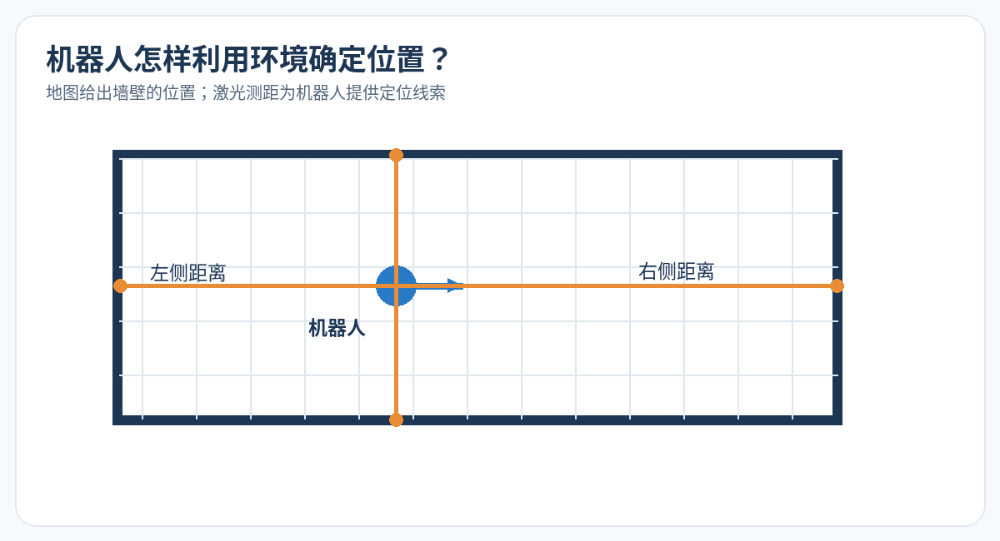

**看图重点：**地图里有墙壁，机器人利用测得的墙壁距离与地图进行比较，推断自己可能在哪里。地图告诉机器人“周围环境是什么样的”，定位则回答“我在哪里、面向哪里”。

**原始网络实验图：**[MathWorks——利用激光扫描实现 SLAM](https://fr.mathworks.com/help/nav/ug/implement-simultaneous-localization-and-mapping-with-lidar-scans.html)（前一版引用的图片地址：[OfflineSLAMExample_04.png](https://fr.mathworks.com/help/examples/nav/win64/OfflineSLAMExample_04.png)，当前可能无法直接加载）。

### 用一个例子理解定位

假设机器人已经有了一张教室地图。它现在观察到前方有一面墙、左侧有桌椅、右侧有门，就可以把这些观测与地图中的环境结构进行比较，判断自己更可能处于哪个位置。

这就像我们进入一个熟悉的教学楼，即使没有查看手机，也能根据走廊、楼梯和教室的位置判断自己在哪里。

**机器人定位的核心，就是根据运动信息和环境观测，不断判断自己处于什么位置。**

---

## 二、机器人移动时，怎样知道自己走了多远？

机器人在运动过程中，首先需要估计自己移动了多少。常见的信息来源包括轮式里程计和 IMU。

### 1. 里程计：根据轮子转动估计距离

里程计（Odometry）是一种根据机器人自身的运动信息推算位置变化的方法。

对于轮式机器人，最直观的方式就是测量轮子的转动。想象自行车：轮子转一圈，车子就会向前移动一段距离。机器人也可以根据轮子的转动估计自己走了多远。

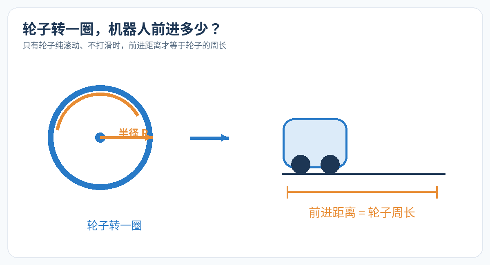

**看图重点：**在轮子不打滑的理想情况下，轮子滚动一圈，机器人向前移动的距离相当于轮子的周长。轮子越大，同样转一圈能移动的距离通常也越远。

不过，机器人还必须知道轮子究竟转了几圈。为此，许多轮式机器人会使用**编码器（Encoder）**。

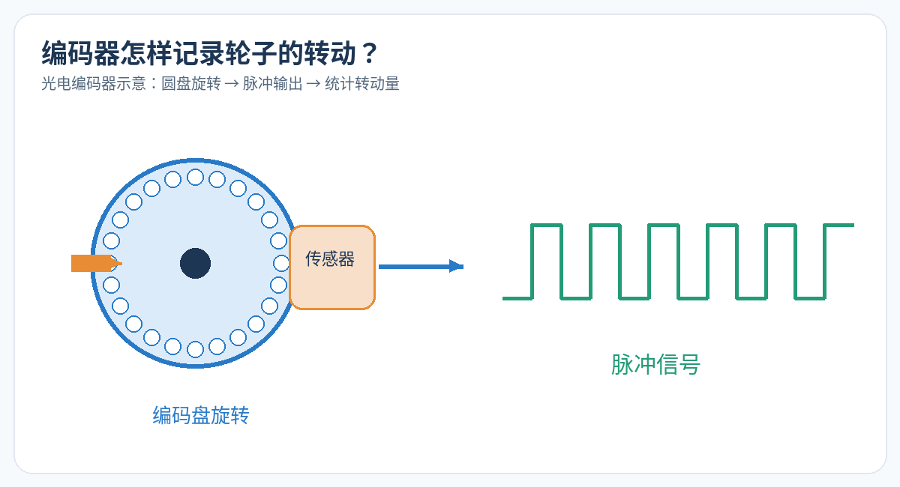

**看图重点：**光学编码器的圆盘跟着轮轴旋转。圆盘上的狭缝经过传感器，形成电脉冲；系统统计脉冲数量，推算轮子转了多少。编码器测的是轮子的转动，而不是机器人在地面上的真实移动距离。

**原始参考图：**[编码器原理介绍](https://robertoibanezmingarro.github.io/web/pages/sailboat.html)；前一版引用的[编码器原图链接](https://robertoibanezmingarro.github.io/web/assets/img/sailboat/encoder_principle.png)。

### 2. 为什么里程计会产生误差？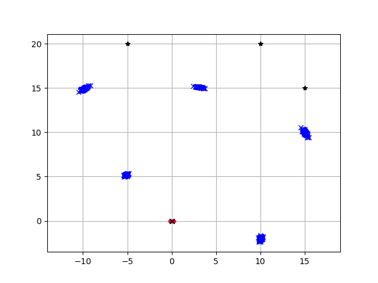

假如只依赖轮子转动来推算位置，误差就可能随着运动逐渐积累。这叫作**里程计漂移（Odometry Drift）**。

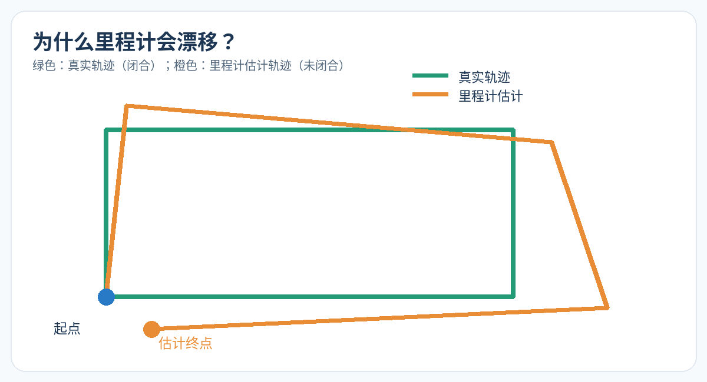

**看图重点：**绿色是实际闭合路线，橙色是根据里程计估算出的路线。机器人真实走了一圈回到起点，但估计轨迹的终点却偏离了起点。

**真实实验图（在线）：**

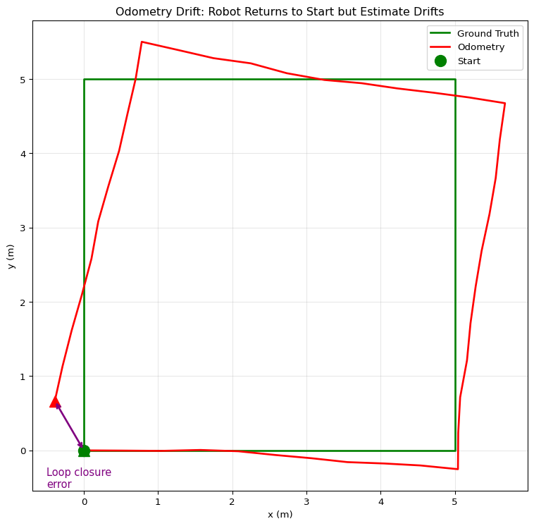

[实验出处：Robot Modeling Control / Pose Graph Optimization](https://poonawalalab.github.io/robotics-course/posegraph.html)。该图中的绿色为真实轨迹，红色为里程计估计轨迹。

造成误差的常见原因有：

- **轮子打滑：**轮子转了，但机器人实际前进得没有估计那么远。
- **参数不准：**系统里设置的轮子半径、轮距与真实情况存在偏差。
- **转向误差：**左右轮转动量估计出错，会使朝向发生偏差，之后的位置误差还可能进一步放大。
- **误差积累：**每次运动的微小偏差随着时间逐渐累积。

因此，里程计能够提供有价值的运动估计，但无法单独保证长期定位准确。

### 3. IMU 如何辅助定位？

IMU（Inertial Measurement Unit）是**惯性测量单元**，通常包含加速度计和陀螺仪。它不是直接告诉机器人“你在地图的哪里”，而是测量机器人自身的运动变化。

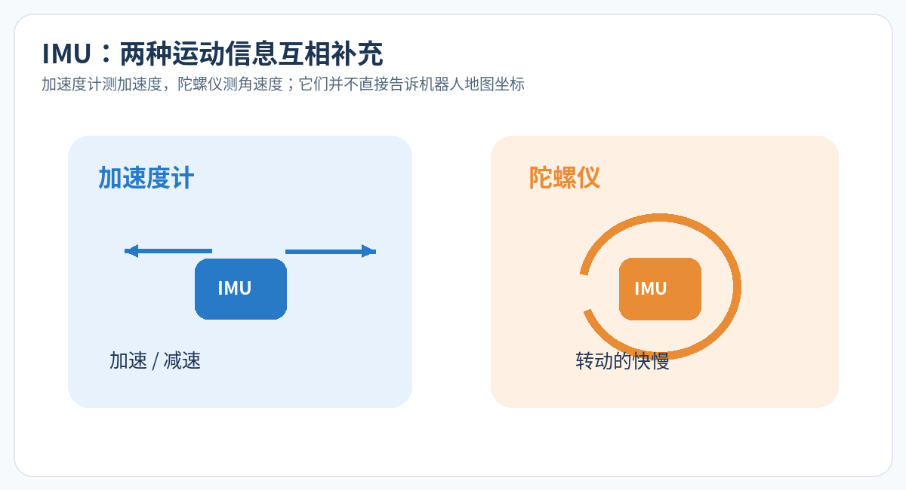

**看图重点：**加速度计可以反映加速、减速及重力方向等信息；陀螺仪测量转动的角速度。例如机器人转弯时，陀螺仪能够提供转动信息。

**原始参考图：**[TDK：Inertial Sensor Configuration](https://www.tdk.com/en/tech-mag/sportstech/002)（之前展示的[图片地址](https://www.tdk.com/en/tech-mag/sites/default/files/2023-02/Vol02_soccer_EN_03.png)）。

把 IMU 与轮式里程计结合起来，可以改善短时间的运动估计；但两者都可能产生误差。因此，机器人还需要利用激光雷达、摄像头等传感器观察外部环境，进一步修正自己的位置。

---

## 三、SLAM 如何利用环境观测修正位置？

里程计和 IMU 负责估计机器人“可能怎样移动了”，但机器人还可以借助环境结构来检查预测是否合理。例如，它能将新的激光扫描与之前的观测进行比较，判断两次观测是否来自同一面墙、同一段走廊。

### 1. 先看机器人实时探索与建图

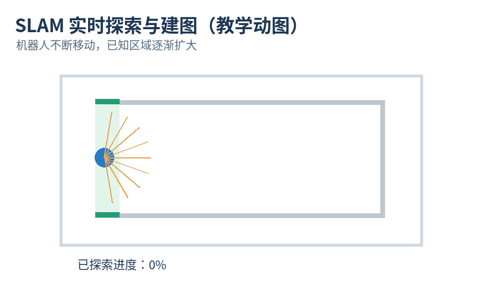

**看动图重点：**机器人移动时，绿色的已探索区域逐渐增加。SLAM 的定位与建图往往在运动过程中持续进行。

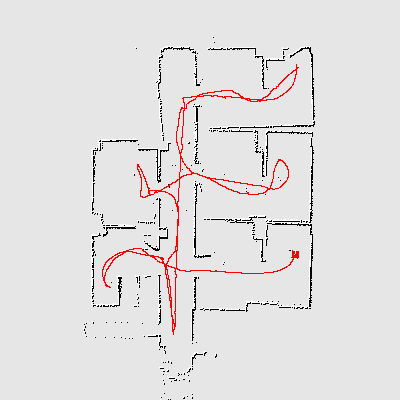

### 2. 扫描匹配：把两次观测对齐

扫描匹配（Scan Matching）就是对比不同时间获取的环境观测，寻找一组合理的位置和方向调整，让相同的环境结构尽可能重合。

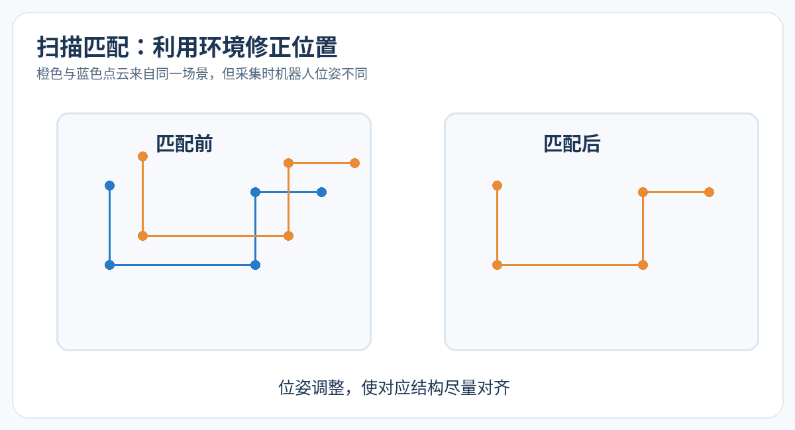

**看图重点：**左边的两组点云存在错位；右边调整后更加重合。通过这种对齐关系，算法可以推断机器人在两次观测之间的运动变化。

一个常见算法叫作 ICP（Iterative Closest Point，迭代最近点），它会反复寻找对应点、调整位置和方向，让两组点云逐渐靠近。

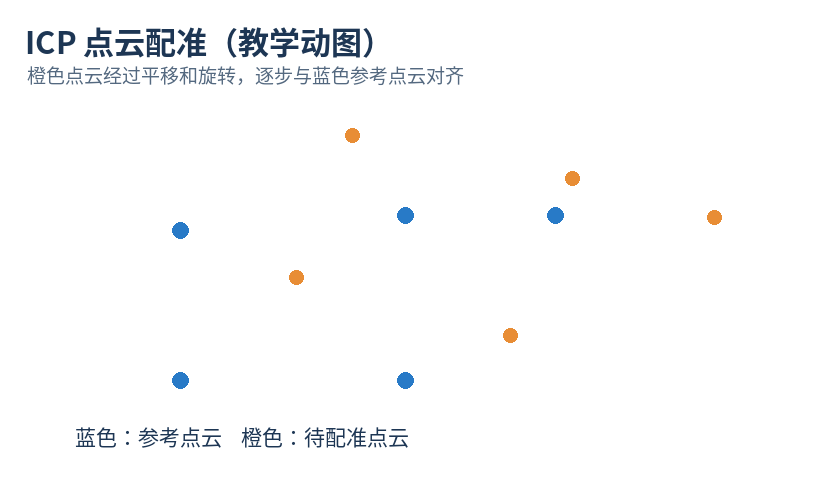

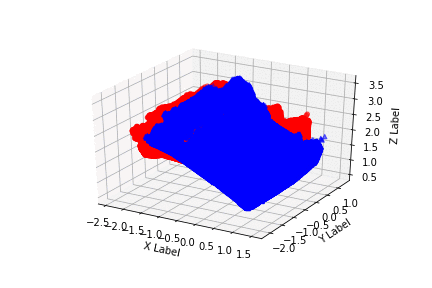

**一句话理解：**里程计提供初步位置预测，扫描匹配利用环境信息帮助修正偏差。

---

## 四、什么是回环检测？为什么它可以修正累计误差？

假设机器人从教室门口出发，沿走廊绕了一圈，又回到了门口。真实世界中，它已经回到起点，但由于累计误差，估计轨迹的终点可能没有与起点重合。

如果机器人认出“这里我以前来过”，就能利用这个信息修正之前的轨迹。这叫作**回环检测（Loop Closure Detection）**。

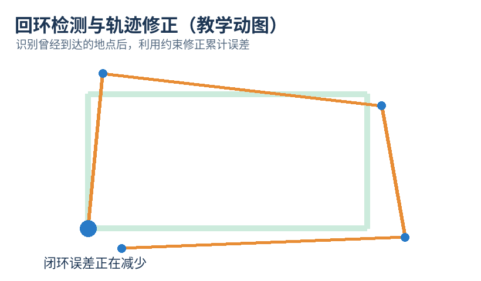

**看动图重点：**开始时轨迹没有闭合，随着回环约束发挥作用，轨迹整体被调整，闭合误差逐渐减小。

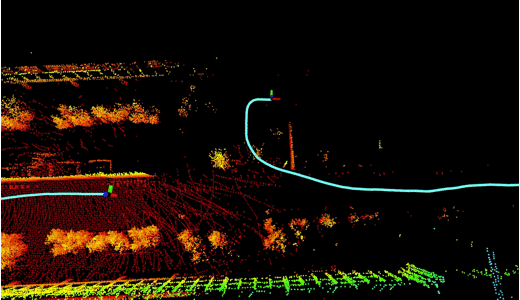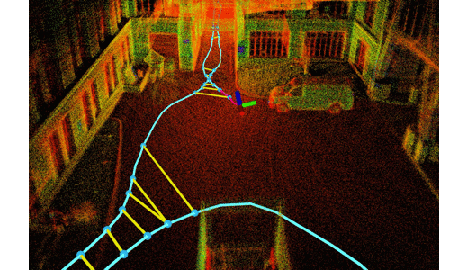

回环检测后，系统还会利用位姿图优化（Pose Graph Optimization）综合运动和回环约束，调整历史轨迹。它不是简单地把终点强行拉回起点。如果把两个不同的地点误认为同一个地点，错误回环反而可能造成地图变形。

---

## 五、已经有地图了，还需要 SLAM 吗？

假设扫地机器人第一天已经建立并保存了房间地图。第二天再次启动，它不一定需要重新建图，但仍然需要判断自己现在位于地图中的哪个位置。

这时可以采用 **AMCL（Adaptive Monte Carlo Localization，自适应蒙特卡洛定位）**。

它是一种在已知地图中估计机器人位置的方法，常用于 ROS 导航系统。

下面的图片展示了 AMCL 在机器人可视化软件 RViz 中的运行效果。

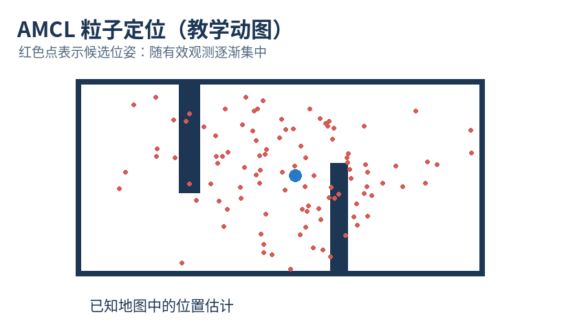

图中红色的箭头状粒子表示机器人可能处于的不同位姿假设。

AMCL 会结合机器人运动信息和激光雷达观测，不断调整这些候选位置的可信程度。随着有效观测不断积累，粒子可能逐渐集中到真实位置附近。

**真实 RViz 实验截图：**

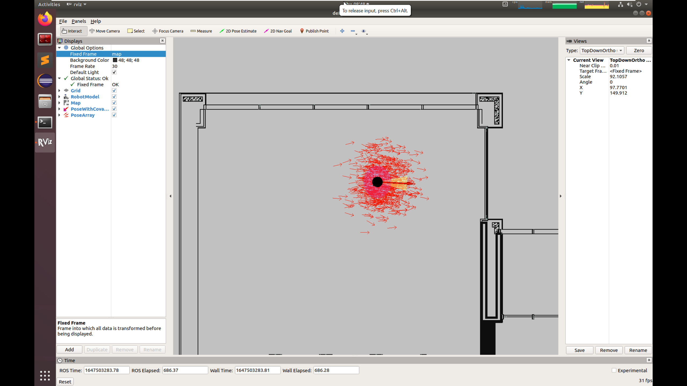

| 对比项目         | SLAM                   | AMCL                 |
| ---------------- | ---------------------- | -------------------- |
| 主要任务         | 同时定位与建图         | 利用已有地图定位     |
| 是否需要已有地图 | 通常不需要完整已有地图 | 需要                 |
| 是否负责建图     | 是                     | 通常不生成新地图     |
| 典型场景         | 首次探索陌生环境       | 地图已经建立后的导航 |

**通俗理解：**SLAM 是“一边认识环境，一边估计位置”；AMCL 是“地图已经有了，重点判断自己在哪”。部分 SLAM 系统也支持使用已有地图定位，两者并非完全互斥。

---

## 六、ROS 中机器人如何管理自己的位置？

机器人本体、雷达以及地图的参考位置可能不同，因此需要通过 **TF 坐标变换**把它们联系起来。

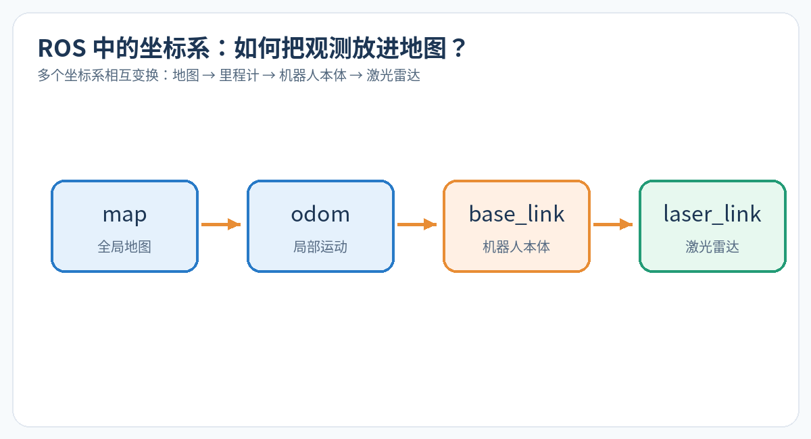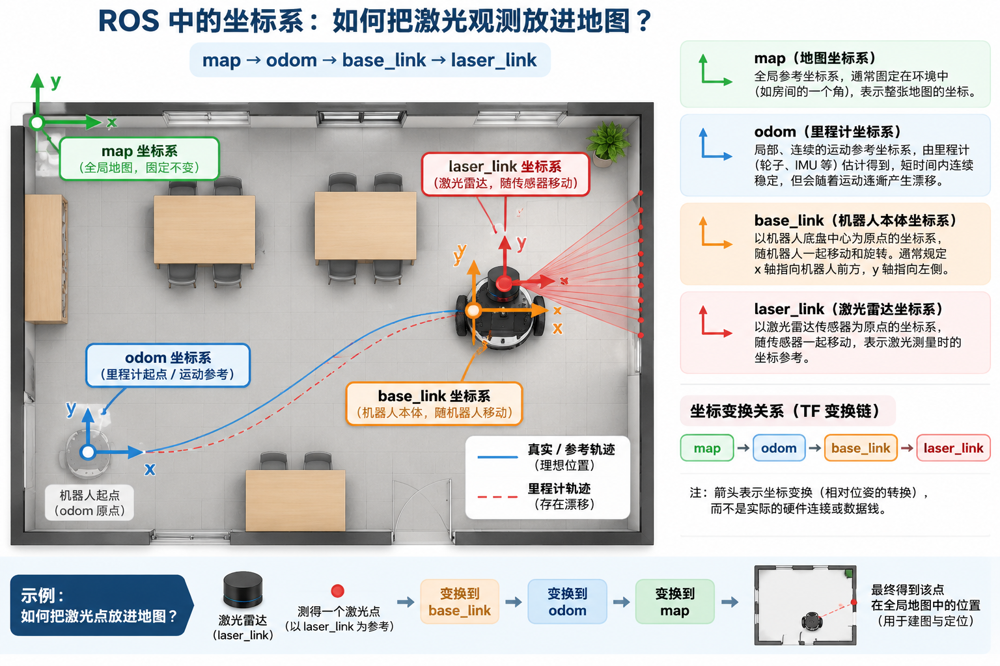

常见坐标系包括：

- `map`：全局地图坐标系，表示机器人在整张地图中的位置。
- `odom`：里程计坐标系，记录连续的局部运动，长期可能漂移。
- `base_link`：机器人本体坐标系。
- `laser_link`：激光雷达的坐标系，具体名称因设备配置而异。

例如，激光雷达测到了前方有一面墙。但这个“前方”是相对于雷达而言的；要把墙壁放进地图，就必须知道雷达相对于机器人的位置，以及机器人相对于地图的位置。

**原始参考图与文档：**[Nav2 / Setting Up Transforms](https://docs.nav2.org/rolling/configuration_and_development/first_time_robot_setup_guide/transformation/setup_transforms.html)；之前引用的[官方坐标变换图片](https://docs.nav2.org/rolling/_images/setup_transforms.png)。

为什么要分别使用 `map` 和 `odom`？因为 `odom` 强调短时运动连续性，而 `map` 强调与全局地图的一致性。定位修正后，机器人在 `map` 中的估计位置可能发生调整，但局部里程计通常保持连续。

---

## 七、哪些因素会导致机器人定位失败？

虽然 SLAM 可以通过环境观测修正位置，但在某些环境下仍可能遇到困难。

**长走廊、重复结构：**环境缺少独特特征，机器人可能把不同地点混淆。

**玻璃、镜面反光：**可能影响部分雷达测距，也会干扰某些视觉算法。

**光线不足、画面模糊：**普通视觉 SLAM 可能难以提取和稳定跟踪图像特征。

**大量动态障碍物：**行人、车辆等持续移动，会让机器人观测到的环境不断变化。

### 机器人突然被搬走，又会怎样？

假设机器人原本已经定位成功，但突然被搬到另一个房间。它原来的位置估计就可能不再正确。这是经典的“被绑架机器人问题”（Kidnapped Robot Problem）。

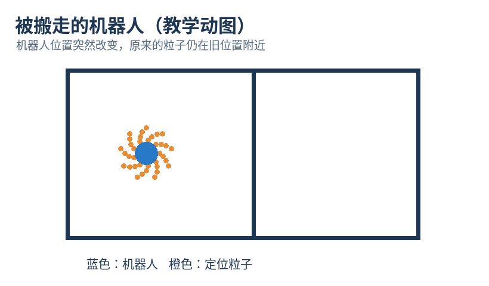

**看动图重点：**蓝色机器人已经移动到右边，但橙色定位粒子仍留在左边，说明系统仍可能相信自己位于原位置。此时往往需要重定位。

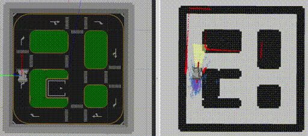

---

## 八、本章总结：机器人到底怎样知道自己在哪里？

下图为之前选定的“五步定位原理”总结图，已保存在图片目录中，可直接离线查看。

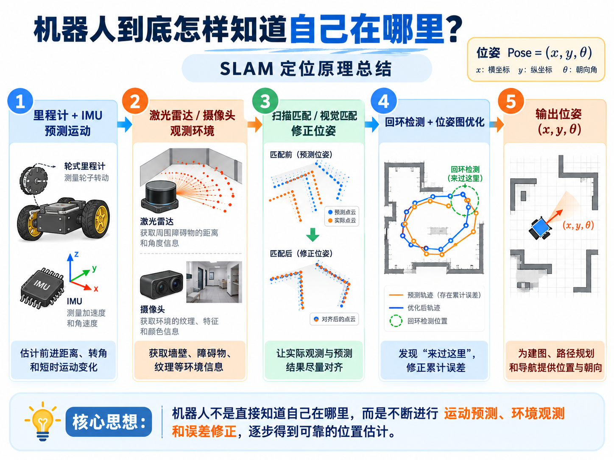

结合图片，可以用五句话概括：

1. **运动估计：**利用里程计和 IMU 推测机器人走了多远、转了多少。
2. **环境观测：**利用激光雷达或摄像头观察墙壁、障碍物等结构。
3. **位置修正：**把实际观测与预测结果比较，修正运动估计的偏差。
4. **回环与优化：**重新识别访问过的地点，利用额外约束减少累计误差。
5. **输出定位结果：**不断更新机器人在地图中的位置和朝向，为后续路径规划和导航提供信息。

这是一张教学用的概念总结图。真实 SLAM 系统通常持续进行运动估计和观测匹配，回环检测和全局优化则在合适的条件下执行，并不是每次定位都必须严格依次经过这五步。

**本章最重要的一句话：机器人并不是直接知道自己在哪里，而是通过运动估计、环境观测和误差修正，不断获得更加可靠的位置判断。**

下一章将进一步介绍：机器人已经知道自己在哪里之后，怎样规划路线、避开障碍物，并安全地到达目标地点？这就是路径规划、避障和运动控制。
