# 第四章：机器人自主导航——从找到路线到真正走过去

> 本章学习主线：理解自主导航 → 了解路径规划 → 学会 A* → 比较其他规划算法 → 动态避障 → 路径跟踪与运动控制 → 回到 ROS1 导航系统。
>
> 图片说明：本文件优先嵌入开源项目与技术文档中的原始图片/GIF。由于图片和 GIF 通过网络地址引用，阅读时需要联网；如果某个网站或 GitHub 资源无法访问，可点击图片下方的原始链接。GIF 均标注为算法仿真或定位/导航仿真，不冒充实体机器人录像。

---

## 第一部分：机器人自主导航是什么？

### 1. 机器人怎样才能自己走到目的地？

假设我们让一台移动机器人从走廊入口出发，自己前往实验室。我们只告诉它目标位置，而不是一路告诉它“向前两米、左转、再向前三米”。机器人需要了解环境、估计自己的位置、决定路线，并控制自身运动。

**自主导航（Autonomous Navigation）**，就是机器人利用环境信息和自身状态，自主决定如何到达目标并执行运动的过程。

### 2. 自主导航需要哪些能力？

| 能力           | 通俗解释                       | 相关技术                |
| -------------- | ------------------------------ | ----------------------- |
| 了解环境       | 知道墙壁、走廊和障碍物在哪里   | 建图 Mapping            |
| 确定自己在哪里 | 估计机器人在地图中的位置和朝向 | 定位 Localization       |
| 决定怎么走     | 从当前位置到目标寻找可行路线   | 路径规划 Path Planning  |
| 真正移动       | 控制机器人前进、转弯、减速     | 运动控制 Motion Control |

### 3. 看看真实 ROS 导航界面

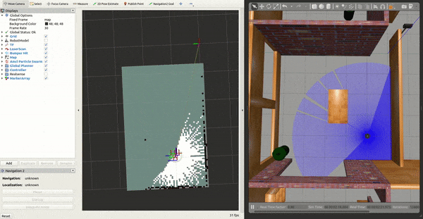

*图片来源：ROS 导航系统 RViz 可视化案例。界面用于查看地图、代价信息和导航轨迹。原图链接：[RViz 导航截图](https://westsideelectronics.com/content/images/2021/03/image-1.png)。*

RViz 是用于展示机器人内部数据的可视化工具。它显示的地图、激光观测和路线不是机器人眼睛看到的现实照片，而是软件把计算结果画出来，方便开发者观察和调试。

### 4. SLAM 和自主导航是什么关系？

- **SLAM（Simultaneous Localization and Mapping，同时定位与建图）**：在地图未知或不完整时，机器人一边估计自己的位置，一边构建环境地图。
- **定位（Localization）**：在已有地图中估计机器人当前的位置和朝向。
- **路径规划（Path Planning）**：根据地图、起点和目标寻找路线。
- **运动控制（Motion Control）**：将运动要求转化为机器人能够执行的控制指令。

SLAM 不是自主导航的全部。SLAM 可以提供地图与位置估计，但机器人要真正到达目标，还需要规划、控制和应对环境变化。

### 5. 一次导航任务怎样发生？

```text
接收目标位置
     ↓
获取地图与自身位置
     ↓
计算整体路线
     ↓
根据局部环境选择运动
     ↓
控制底盘执行
     ↓
持续更新状态，必要时调整路线
```

**本节小结：** 自主导航不是某一个算法单独完成的，而是环境感知、定位、路径规划和运动控制相互配合的结果。

---

## 第二部分：机器人怎样从起点找到终点？

### 1. 机器人拿到地图后，怎样判断哪里能走？

机器人常用的一种地图叫**占据栅格地图（Occupancy Grid Map）**。可以把它理解成由许多小格子组成的地图，每个格子记录该位置是否可能被障碍物占据。

- **空闲区域**：机器人判断这里可以通行。
- **占据区域**：机器人判断这里存在墙壁或障碍物。
- **未知区域**：机器人目前还不能确定这里的情况。

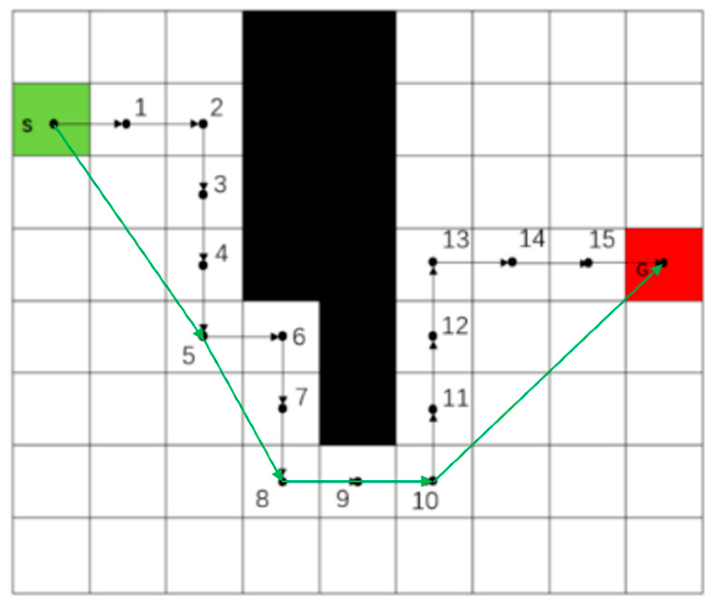

*图片来源：MDPI 论文中的路径规划示意图。它展示了地图中的障碍物、起点、终点与规划路线。原图链接：[MDPI 路径规划图](https://www.mdpi.com/electronics/electronics-13-00455/article_deploy/html/images/electronics-13-00455-g002.png)。*

路径规划算法不是直接看着现实照片决定怎么走，而是根据地图和相关环境信息计算路线。如果地图没有及时更新，现实中新出现的障碍物仍需要传感器和后续规划机制处理。

### 2. 为什么机器人不能只走最短路线？

最短路线不一定是最安全或综合代价最低的路线。比如，机器人可能沿桌角贴边通过，也可能稍微绕远一点，留出更大的安全距离

*图片来源：Frontiers in Robotics and AI，论文关于分层代价地图与辐射规避的研究。该图中的额外代价来自辐射风险，是代价感知规划的特殊应用，不应误认为普通室内避障实验。原图链接：[Frontiers 论文图](https://www.frontiersin.org/files/Articles/862067/xml-images/frobt-09-862067-g001.webp)。*

这张图说明：**最短路线与综合代价更低的路线不一定相同。** 在普通室内导航中，代价可以用来鼓励机器人远离墙角、桌腿或其他障碍物；在特殊场景中，代价也可以表示危险区域或限行区域。

### 3. 代价地图是什么？

**代价地图（Costmap）**是在地图上为不同位置附加“通行代价”信息。代价高通常意味着机器人应该尽量避免经过；障碍物所在的位置则通常被标记为不可通行。

#### 什么是障碍物膨胀？

**障碍物膨胀（Obstacle Inflation）**可以理解为：在墙壁、桌腿等障碍物周围建立一圈具有不同代价的缓冲区域。

这样做是因为机器人本身有宽度。即使机器人中心没有进入墙壁所在的位置，车身也可能碰到墙壁。让规划器尽量远离障碍物，可以减少贴墙行驶和擦碰的风险。

注意：膨胀区域不一定全部禁止通行。部分区域只是代价较高，规划器仍可能选择通过；禁止区域与高代价区域需要区分。

### 4. 路径规划到底需要什么输入？

```text
地图：哪里可以走？
起点：机器人现在在哪里？
目标点：机器人需要到哪里？
代价信息：哪些位置更值得避开？
          ↓
       路径规划器
          ↓
   从起点通向目标的路线
```

地图、起点和目标是最基本的输入。实际规划器还可能使用代价信息和机器人运动约束。规划出的路线也不等于机器人最终走过的轨迹，机器人还需要后续控制与避障才能执行。

---

## 第三部分：A* 算法——机器人怎样一步步找到路线？

### 1. A* 是什么？

**A*（A-Star，A 星算法）**是一种路径搜索算法。它逐步检查候选位置，并优先探索那些看起来更有希望通向目标的位置。

可以把它想象成在迷宫中找路：你既会考虑已经走了多远，也会估计离出口还有多远。A* 用明确的计算规则综合这两类信息。

### 2. GIF：A* 怎样搜索路线？


*来源：PythonRobotics 开源项目。原始 GIF：[A* animation.gif](https://github.com/AtsushiSakai/PythonRoboticsGifs/raw/master/PathPlanning/AStar/animation.gif)。这是算法仿真，不是真实机器人录像。项目说明：[PythonRobotics 文档](https://atsushisakai.github.io/PythonRobotics/modules/5_path_planning/grid_base_search/grid_base_search.html)。*

观察时重点看三件事：

1. 搜索区域逐步扩大，表示算法正在检查候选位置。
2. 障碍物会影响搜索，算法不能直接穿过墙壁。
3. 找到目标后，算法会利用搜索过程中记录的信息恢复路线。

注意：搜索过的位置不是机器人实际走过的轨迹。GIF 展示的是算法如何计算路线。

### 3. A* 凭什么决定先搜索哪里？

A* 使用一个综合评分：

\[
f(n)=g(n)+h(n)
\]

- \(g(n)\)：从起点到当前位置已经付出的代价。
- \(h(n)\)：从当前位置到终点的剩余代价估计。
- \(f(n)\)：用于决定优先探索顺序的综合评分。

举例：

| 候选位置 | 已走代价 \(g\) | 剩余估计 \(h\) | 综合评分 \(f\) |
| -------- | -------------: | -------------: | -------------: |
| A        |              4 |              3 |              7 |
| B        |              2 |              8 |             10 |

A 的综合评分更低，因此 A* 通常会优先考虑 A。但这不代表 A 一定属于最终路线，它只是当前更值得优先探索的位置。

在简单二维网格中，\(h(n)\) 可以使用到终点的距离估计。在启发式函数满足相应条件时，A* 能保证找到最小代价路线。

### 4. A* 的能力与局限

- 可以根据地图搜索路线，但不能保证现实中永远没有新障碍物。
- 网格越细，通常能表达越精细的位置差异，但需要处理和存储的格子也会增加。
- 普通网格 A* 可能得到带有明显折角的路线，不自动保证机器人能平滑执行。
- 最优性取决于代价定义和启发式函数等条件。

**本节小结：** A* 会综合考虑已经付出的代价和剩余代价的估计，决定优先探索哪些位置。

---

## 第四部分：为什么还需要其他路径规划算法？

不同任务对规划器的要求不一样。有的任务主要在网格上寻找最小代价路线；有的需要考虑汽车能否转弯；还有的需要在连续或高维空间中探索可行路径。

### 1. Dijkstra：从起点向外逐渐探索

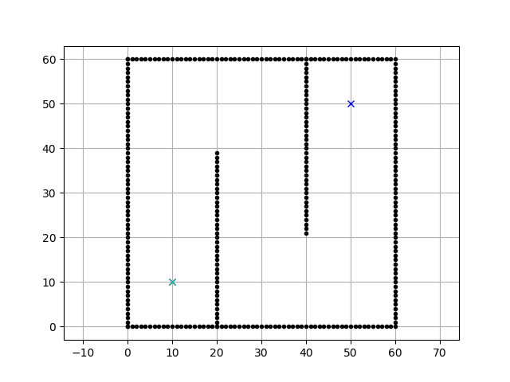

*来源：PythonRobotics 开源项目。原始 GIF：[Dijkstra animation.gif](https://github.com/AtsushiSakai/PythonRoboticsGifs/raw/master/PathPlanning/Dijkstra/animation.gif)。*

Dijkstra 优先探索当前累计路径代价最小的位置，不需要估计目标方向。在边代价非负等标准条件下，它可以找到最小代价路线，但可能探索许多与目标无关的区域。

### 2. A*：利用目标信息引导搜索


A* 在累计代价之外，加入剩余代价的估计，因此通常更有目标性。它并非必然更快，实际效果取决于地图、代价设置和启发式函数。

| 对比项           | Dijkstra                   | A*                      |
| ---------------- | -------------------------- | ----------------------- |
| 优先依据         | 已知累计代价               | 已知代价 + 剩余代价估计 |
| 是否利用目标信息 | 不需要                     | 使用启发式估计引导搜索  |
| 搜索表现         | 可能向目标以外区域扩展较多 | 通常更有目标性          |
| 最小代价保证     | 标准条件下可以             | 启发式满足条件时可以    |

### 3. Hybrid A*：为什么汽车不能只按照普通网格找路？

汽车不能像差速轮小车那样随意原地旋转，也不能横着移动。它的转弯受到转向角和最小转弯半径等限制。

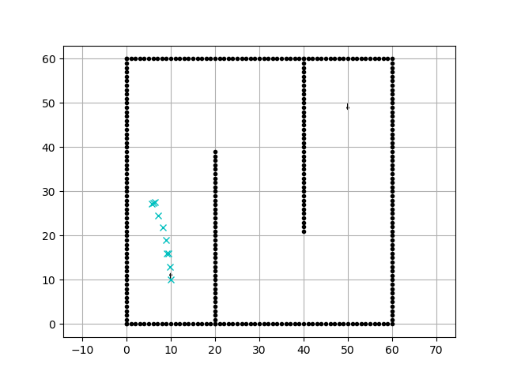

*来源：PythonRobotics。原始 GIF：[Hybrid A* animation.gif](https://github.com/AtsushiSakai/PythonRoboticsGifs/raw/master/PathPlanning/HybridAStar/animation.gif)；说明：[Hybrid A* 官方演示](https://atsushisakai.github.io/PythonRobotics/modules/5_path_planning/hybridastar/hybridastar.html)。这是车辆模型仿真。*

Hybrid A* 在搜索中进一步考虑车辆的位置、朝向和运动模型，适合汽车式机器人、自动泊车以及有明显转弯约束的车辆。它并不是所有室内差速小车都必须使用的方法。

### 4. RRT / RRT*：通过采样探索复杂空间

RRT（Rapidly-exploring Random Tree，快速探索随机树）会不断采样新的位置，并尝试从已有搜索树扩展过去。

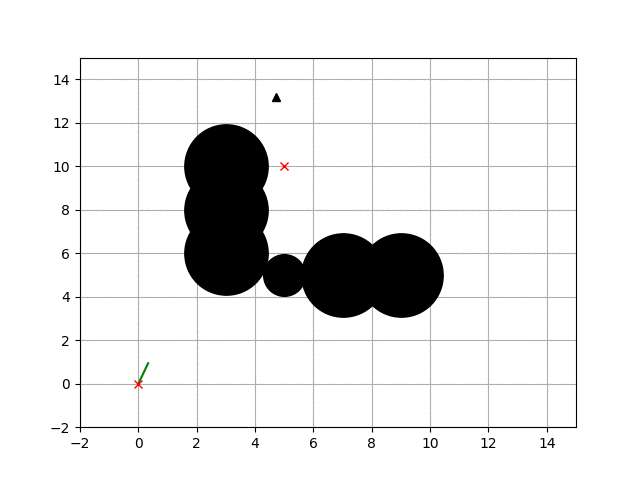

*来源：PythonRobotics。原始 GIF：[RRT animation.gif](https://github.com/AtsushiSakai/PythonRoboticsGifs/raw/master/PathPlanning/RRT/animation.gif)。绿色线条是逐渐扩展的搜索树，障碍物限制了树枝可以延伸的方向。*

RRT 找到可行路线后，不保证它就是最短路线。RRT* 会通过重新选择连接方式和调整部分节点，逐渐改善路线代价。在适当理论条件下，RRT* 具有渐近最优性，但不意味着它每次都更快或有限时间内必然得到最短路线。


*原始 GIF：[RRT* animation.gif](https://github.com/AtsushiSakai/PythonRoboticsGifs/raw/master/PathPlanning/RRTstar/animation.gif)。*

### 5. 四种方法怎么选？

| 算法       | 核心思路                | 典型适用场景               |
| ---------- | ----------------------- | -------------------------- |
| Dijkstra   | 按累计代价扩展搜索      | 网格或图上的最小代价搜索   |
| A*         | 累计代价 + 剩余代价估计 | 普通二维地图上的全局规划   |
| Hybrid A*  | 搜索时考虑车辆运动模型  | 汽车式机器人、自动泊车     |
| RRT / RRT* | 通过采样扩展搜索树      | 连续或较高维空间的运动规划 |

这些算法并非完全处于同一层次、可以随意互换。选择时需要考虑地图表示、机器人运动能力、计算资源和规划目标。

---

## 第五部分：机器人遇到突然出现的障碍物怎么办？

### 1. 为什么有了全局路线，还需要局部规划？

全局路径规划主要回答：“从起点到目标，整体上应该走哪条路线？”局部路径规划主要回答：“根据当前状态和附近障碍物，接下来应该怎样运动？”

如果原路线突然被纸箱挡住，机器人需要利用更新后的障碍物信息，寻找安全的局部运动方案。通道完全堵住时，它可能需要停车等待或重新规划整体路线。

### 2. DWA：机器人怎样比较候选运动？

DWA（Dynamic Window Approach，动态窗口法）是一种经典局部规划方法。它会考虑多种可能的速度组合，预测对应的短期轨迹，再从中选择当前合适的运动方案。

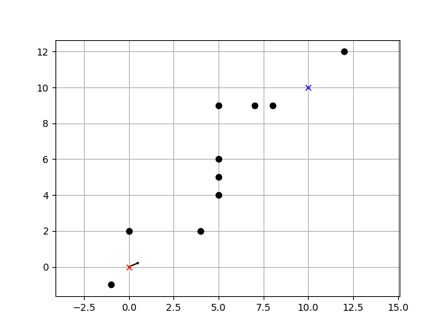

*来源：PythonRobotics。原始 GIF：[DWA animation.gif](https://github.com/AtsushiSakai/PythonRoboticsGifs/raw/master/PathPlanning/DynamicWindowApproach/animation.gif)。这是算法仿真，不是真实机器人录像。*

DWA 的过程可以概括为：

1. 获取当前速度、姿态和附近障碍物信息。
2. 生成可行的候选速度。
3. 预测各候选速度对应的短期轨迹。
4. 排除碰撞风险高或不可执行的轨迹，再比较剩余方案。
5. 输出当前选中的速度指令，之后重新感知并再次规划。

### 3. 遇到障碍物时，机器人如何选择？

- **继续直行**：如果预测轨迹与障碍物冲突，就不能安全执行。
- **绕行**：只有在旁边存在足够空间且轨迹可执行时，才可以选择绕行。
- **减速或停车**：如果不存在安全的可行轨迹，停车可能是更合理的选择。

DWA 会结合障碍物距离、目标方向、与全局路线的接近程度和运动能力等因素评估候选方案。具体权重取决于系统配置。

### 4. 全局规划与局部规划的区别

| 对比项     | 全局规划                   | 局部规划                       |
| ---------- | -------------------------- | ------------------------------ |
| 主要任务   | 计算整体路线               | 选择当前更合适的运动方案       |
| 主要依据   | 地图、起点、目标、通行代价 | 当前状态、局部障碍物、全局路线 |
| 常见方法   | Dijkstra、A* 等            | DWA 等                         |
| 环境变化时 | 必要时重新规划整体路线     | 持续调整近期运动               |

**本节小结：** 全局规划决定整体上往哪里走，局部规划根据眼前环境调整接下来的运动。局部规划并不保证任何情况下都能绕开障碍物。

---

## 第六部分：规划好了路线，机器人为什么还需要路径跟踪和运动控制？

规划路线只是地图上的参考线。机器人真正运动时，可能因为转向响应、定位误差、速度变化和运动约束而偏离路线。因此，还需要路径跟踪与运动控制。

### 1. Pure Pursuit：盯着前方目标点跟踪路线

Pure Pursuit（纯跟踪）会在机器人前方的参考路径上选择一个目标点，再根据目标点相对机器人的位置计算转向。

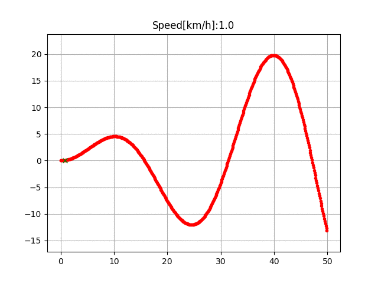

*来源：PythonRobotics。原始 GIF：[Pure Pursuit animation.gif](https://github.com/AtsushiSakai/PythonRoboticsGifs/raw/master/PathTracking/pure_pursuit/animation.gif)；说明：[Pure Pursuit 官方演示](https://atsushisakai.github.io/PythonRobotics/modules/6_path_tracking/pure_pursuit_tracking/pure_pursuit_tracking.html)。这是车辆运动仿真，不是真实机器人录像。*

观察时重点看：参考路线、前方目标点，以及车辆实际跟踪的轨迹。控制器会不断更新目标点并调整转向，而不是只计算一次转向就结束。

### 2. 前瞻距离有什么影响？

**前瞻距离（Lookahead Distance）**是机器人选择前方目标点时所参考的距离。

- 前瞻距离较短：对眼前路径变化更敏感，但可能频繁转向。
- 前瞻距离较长：运动可能更平滑，但在弯道处也可能切弯、偏离路径。

没有一个对所有机器人都最好的固定值，需要根据速度、转弯能力和路线形状调整。

### 3. 更多路径跟踪 GIF

#### Stanley 控制：根据路线偏差调整转向

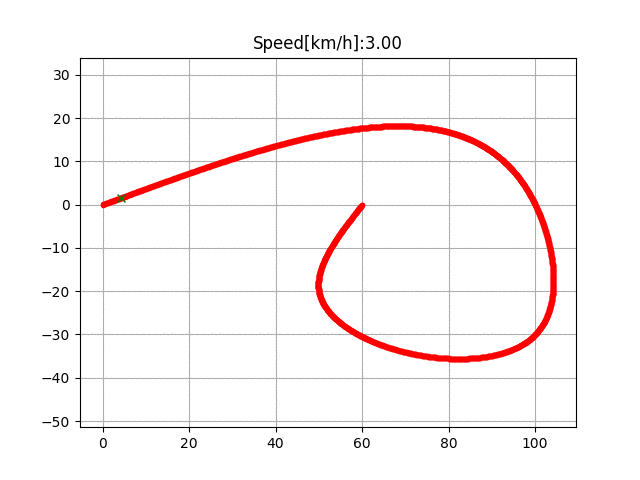

*原始 GIF：[Stanley animation.gif](https://github.com/AtsushiSakai/PythonRoboticsGifs/raw/master/PathTracking/stanley_controller/animation.gif)。Stanley 控制会综合考虑车辆与参考路径之间的位置偏差，以及车辆朝向与路线方向之间的差异。*

#### 后轮反馈控制：根据当前误差修正运动

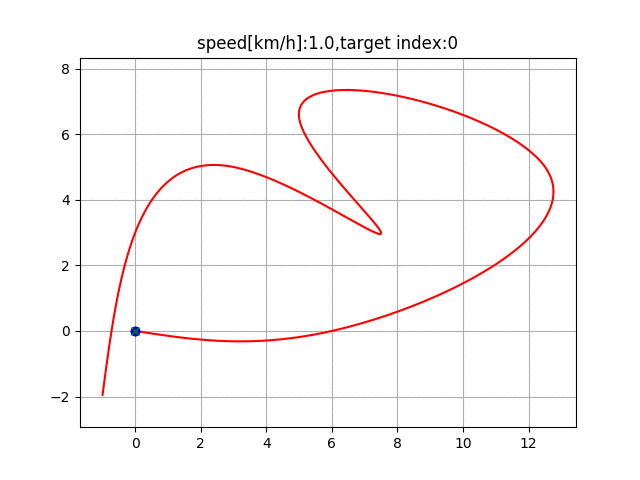

*原始 GIF：[Rear wheel feedback animation.gif](https://github.com/AtsushiSakai/PythonRoboticsGifs/raw/master/PathTracking/rear_wheel_feedback/animation.gif)。该方法利用车辆后轮相关的位置误差计算转向。*

#### LQR：综合考虑状态偏差与控制代价

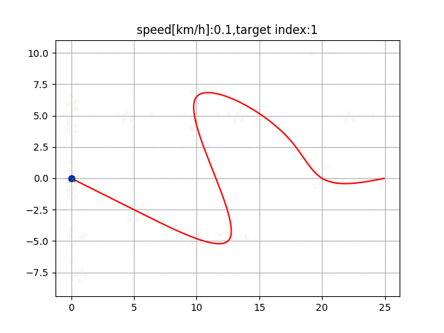

*原始 GIF：[LQR animation.gif](https://github.com/AtsushiSakai/PythonRoboticsGifs/raw/master/PathTracking/lqr_speed_steer_control/animation.gif)。LQR（Linear Quadratic Regulator，线性二次型调节器）会综合考虑状态偏差和控制动作的代价。*

以上都是算法仿真动画，不是实体机器人实验录像。它们的用途是展示不同控制器如何逐步修正路径跟踪误差。

### 4. 路径跟踪和运动控制有什么区别？

路径跟踪主要决定怎样调整运动以尽量沿着参考路线行驶；运动控制则涉及如何将要求转化为机器人能够执行的速度、转向或车轮指令。比如 Pure Pursuit 可以计算转向要求，速度控制则可以由 PID 等方法承担。

**本节小结：** 路径规划负责计算希望机器人走的路线；路径跟踪和运动控制负责让机器人尽可能按路线实际运动。

---

## 第七部分：真实 ROS1 导航系统怎样把这些技术组合起来？

### 1. ROS1 导航系统的模块

ROS1 Navigation Stack 接收里程计、传感器数据和目标位置，经过定位与规划后，输出可发送给移动底盘的速度指令。官方组件包括 `amcl`、`map_server`、`move_base`、`global_planner`、`dwa_local_planner` 和 `costmap_2d` 等。

官方资料：

- [ROS Navigation Stack 项目概览](https://index.ros.org/r/navigation/)
- [ROS Navigation Stack 官方仓库](https://github.com/ros-planning/navigation)
- 

1. 先看真实导航系统运行的样子

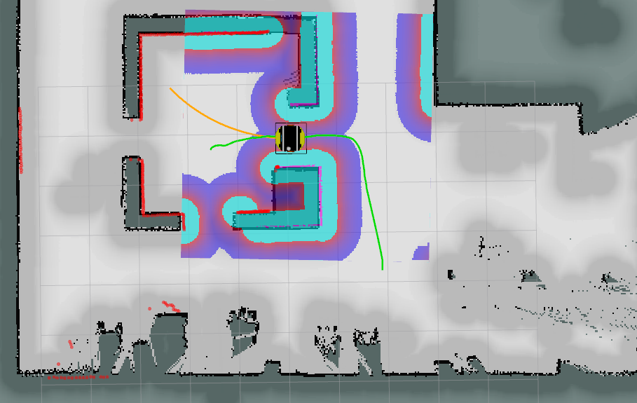

参考：ROS1 导航栈的 RViz 运行界面。你可以观察地图、机器人位置、激光观测、全局路线和局部轨迹。
ROS Package Overview+1


2. 一次完整导航任务中，各个模块怎样配合？
假设你在 RViz 中点击 2D Nav Goal，指定机器人要去的位置。之后，导航系统会逐步完成以下工作。

第一步：定位——确认机器人在哪里

AMCL 根据已有地图和激光雷达等传感器信息，估计机器人在地图中的位置与朝向。

第二步：全局规划——算出整体路线

全局规划器根据地图、起点和目标计算一条可行路线。具体使用哪种算法，取决于配置的规划器。

第三步：局部规划——决定眼下怎样走

DWA 等局部规划器会结合当前状态和局部代价地图，选择合适的速度指令。

第四步：底盘执行——机器人真正移动

底盘控制系统接收速度指令，驱动车轮运动；定位与传感器数据继续更新，导航系统再根据新的状态调整动作。

ROS1 导航栈的核心作用，就是接收目标位置、里程计和传感器信息，经过规划与控制后，输出供移动底盘执行的速度指令。
ROS Package Overview+1

看一段完整的真实机器人导航演示
实体机器人 · ROS1 · AMCL + move_bass

### 3. 完整导航 GIF：从目标点到实际运动

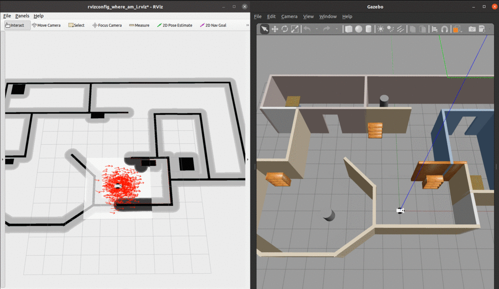

*来源同上。原始 GIF：[navigation.gif](https://raw.githubusercontent.com/elena-ecn/RoboticsND-Where-Am-I/main/images/navigation.gif)。这是导航仿真，不是实体机器人录像。*

这段动图用于收束整章：机器人接收目标后，需要结合定位、全局规划、局部规划和运动控制，逐步完成导航任务。

### 4. ROS1 一次导航任务的工作过程

| 模块                   | 作用                           | 对应本章知识      |
| ---------------------- | ------------------------------ | ----------------- |
| `gmapping`           | 根据传感器数据构建地图         | 建图              |
| `map_server`         | 提供已经保存的地图             | 地图输入          |
| `AMCL`               | 在已有地图中估计机器人位置     | 定位              |
| 全局规划器             | 计算整体路线                   | A* 等全局规划思路 |
| 局部规划器（例如 DWA） | 根据附近障碍物选择近期运动方案 | 局部规划与避障    |
| 底盘控制               | 把速度指令转化为实际运动       | 运动控制          |

注意：`gmapping` 主要用于建图，并不是每次导航都必须运行。已有地图时，机器人可以加载地图并使用定位模块进行导航。实际系统采用的全局规划器和局部规划器也取决于配置。

### 5. 机器人有路线，却为什么走不动？

| 现象                   | 需要检查的方向                             |
| ---------------------- | ------------------------------------------ |
| 全局路线生成失败       | 地图是否连通、目标是否可达、规划器是否正常 |
| 机器人贴墙行驶         | 代价地图、膨胀半径、机器人尺寸设置         |
| 机器人不断左右摆动     | 局部规划参数、定位误差、控制响应           |
| 遇到障碍物后停住       | 是否存在安全轨迹，是否需要等待或重新规划   |
| 路线正确但实际运动偏离 | 定位、里程计、路径跟踪与底盘控制           |

这些只是常见排查方向，不能仅凭一个现象就断定故障原因。真实工程中需要结合 RViz、传感器数据和运行日志判断。

---

## 本章总结

机器人自主导航不是某一个算法单独完成的，而是多个功能相互配合的结果：

- 地图和定位帮助机器人了解环境与自身状态。
- 全局规划决定整体路线。
- 局部规划根据附近环境调整近期运动。
- 路径跟踪和运动控制让机器人真正行动起来。
- 传感器反馈让系统能够不断更新状态，并在必要时重新调整。

**整章主线：理解自主导航 → 根据地图规划路线 → 理解 A* 与其他算法 → 处理动态障碍物 → 跟踪路线并控制运动 → 回到 ROS1 导航系统。**

## 图片与 GIF 来源汇总

- [PythonRobotics 文档与算法演示](https://atsushisakai.github.io/PythonRobotics/)
- [PythonRobotics 动画 GIF 仓库](https://github.com/AtsushiSakai/PythonRoboticsGifs)
- [ROS1 Navigation Stack](https://github.com/ros-planning/navigation)
- [RoboticsND-Where-Am-I（AMCL 与导航仿真）](https://github.com/elena-ecn/RoboticsND-Where-Am-I)
- [MDPI 路径规划示意图](https://www.mdpi.com/electronics/electronics-13-00455/article_deploy/html/images/electronics-13-00455-g002.png)
- [Frontiers 代价感知规划示意图](https://www.frontiersin.org/files/Articles/862067/xml-images/frobt-09-862067-g001.webp)
- [ROS Navigation Stack 官方文档概览](https://index.ros.org/r/navigation/)
