# 第五章：自主移动机器人的现状、挑战与未来发展

> **建议展示时间：5 分钟**
> **结构：前半部分展示现在能做到什么，后半部分讨论当前痛点与未来发展。**
> 本章不重复前四章的 SLAM、定位、A\*、DWA 原理，也不展开 ROS 2
> 安装和配置教程。

---

> **真实素材说明：** 本章同时使用原创教学示意图与真实网络素材。真实图片、科研实验截图和 GIF 已在正文中以原始来源在线嵌入，并附来源链接。当前制作环境无法直接下载外部图片二进制文件，若需离线 PPT 素材，请运行压缩包中的 `下载真实图片素材.ps1`，将原图下载到 `assets/真实网络素材/`。

## 本章核心问题

**机器人已经能够自主移动了，但它能否真正理解复杂环境、适应现实变化，并安全可靠地完成任务？**

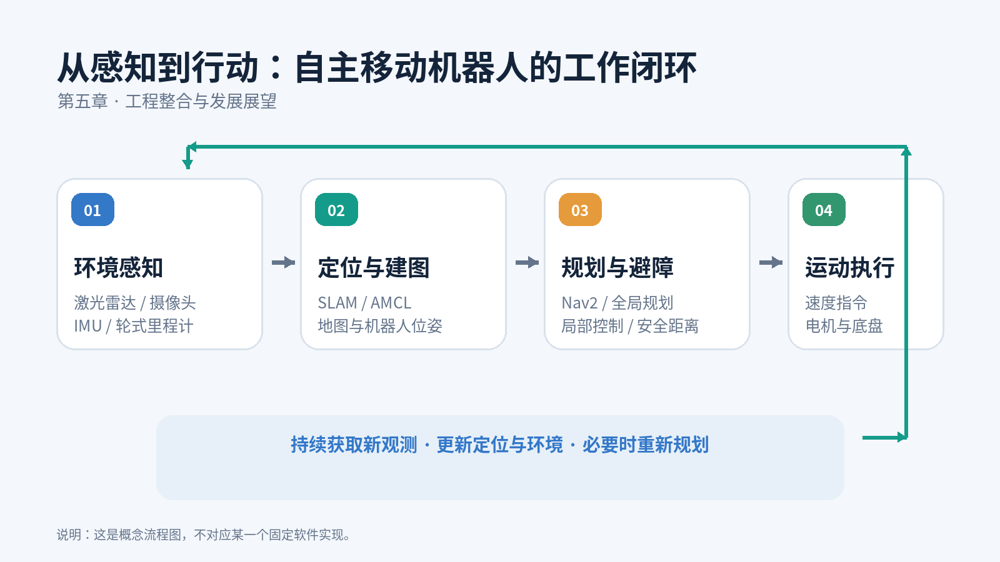

*图
1｜自主导航系统工作闭环（自制示意图）。传感器获取环境信息，定位与建图模块提供地图和位姿，导航模块规划路线，底盘执行运动，并通过新观测持续反馈。*

---

# 第一部分：现在的机器人已经能做到什么？（约 2 分 30 秒）

## 1. 自主移动机器人已经进入哪些实际场景？

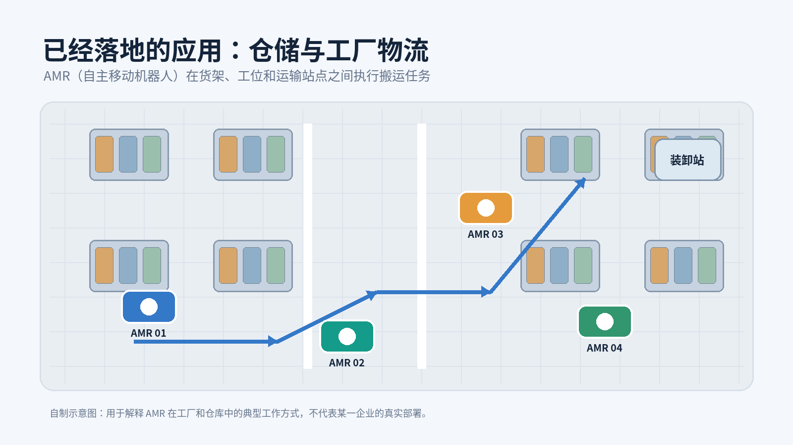

*图 2｜AMR
仓储应用（自制示意图）。多台自主移动机器人在货架、工位和装卸站之间执行物料搬运。*

### 真实场景照片：仓库中的 AMR 车队

*真实仓储照片｜Dem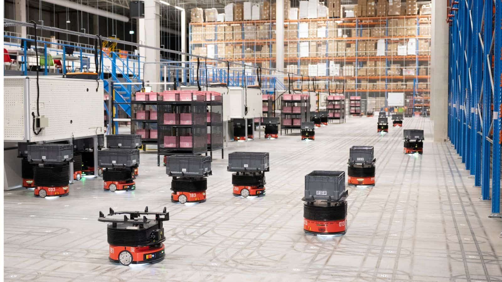atic 官方文章展示的仓库 AMR 运行场景，可用于说明自主移动机器人已进入实际物流系统。*

来源：[Dematic：How Dematic software and AMRs are revolutionizing logistics](https://www.dematic.com/en-be/insights/articles/how-dematic-software-and-amrs-are-revolutionizing-logistics/)

目前较成熟的应用包括：

- **仓储物流：** 货物搬运、分拣、货架运输。
- **工业制造：** 生产线物料配送、工位间运输。
- **服务场景：** 医院配送、酒店服务、园区巡检。

需要注意：这些应用通常运行在经过规划、部署和管理的场景中，并不代表机器人已经能够在任何陌生环境中自由行动。

## 2. 看看机器人如何建立地图

*GIF 1｜SLAM
实时建图原理演示（自制动画，并非真实实验录像）。蓝色机器人沿环境移动，橙色射线表示传感器观测，墙体轮廓随着观测逐步形成。*

### 真实软件运行画面：RViz 中的 SLAM 建图

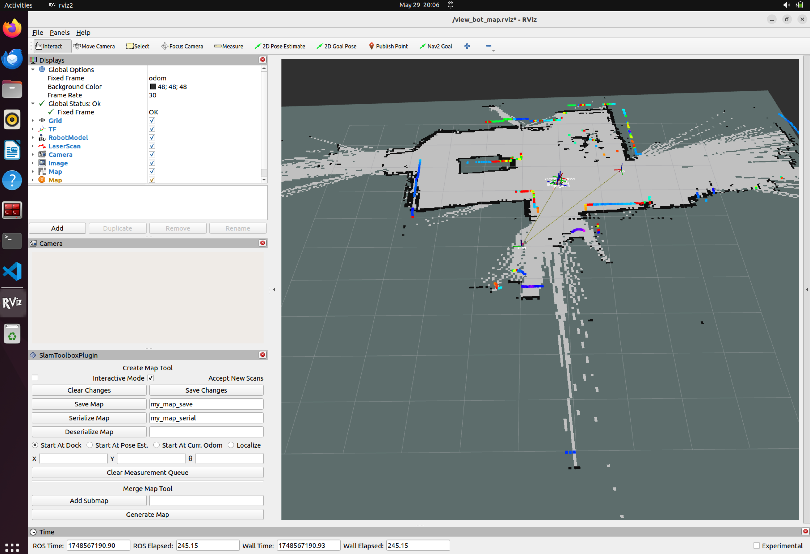

*真实软件截图｜ROS 2 + SLAM Toolbox 在 RViz 中的建图界面。左侧是 RViz 显示与 SLAM Toolbox 插件，右侧是地图和扫描结果。此图是软件运行截图，不是实体机器人照片。*

来源：[Robot Auto Mapping using Nav2 SLAM Toolbox（Medium）](https://medium.com/%40jiayi.hoffman/robot-auto-mapping-using-nav2-slam-toolbox-40b575433fb0)

### 真实建图 GIF：SLAM Toolbox 实验记录

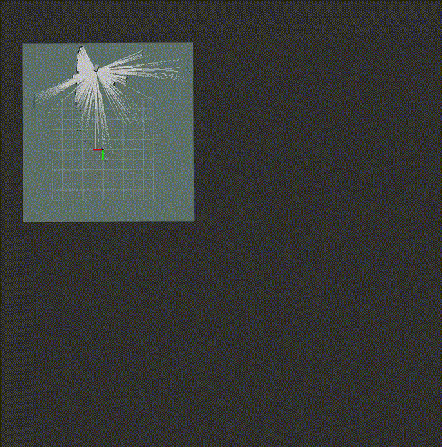

### 补充真实画面：三维 SLAM 点云地图

*真实软件截图｜RTAB-Map 在 RViz 中显示室内三维点云、机器人轨迹与地图信息，可用于补充说明三维 SLAM 的实际输出。*

来源：[Yahboom：RTAB-Map 3D Mapping Navigation](<https://www.yahboom.net/public/upload/upload-html/1699598469/11.RTAB-Map%203D%20mapping%20navigation.html>)

## 3. 看看机器人遇到障碍物后如何调整路线

*GIF
2｜动态避障原理演示（自制动画，并非真实实验录像）。临时障碍物出现后，机器人不再沿原路线直行，而是调整路线绕行。*

真实算法动画可参考：

- [PythonRobotics：Dynamic Window
  Approach（DWA）](https://atsushisakai.github.io/PythonRobotics/modules/5_path_planning/dynamic_window_approach/dynamic_window_approach.html)
- [DWA 原始
  GIF](https://github.com/AtsushiSakai/PythonRoboticsGifs/raw/master/PathPlanning/DynamicWindowApproach/animation.gif)

### 真实导航界面：Gazebo 与 RViz 联合运行

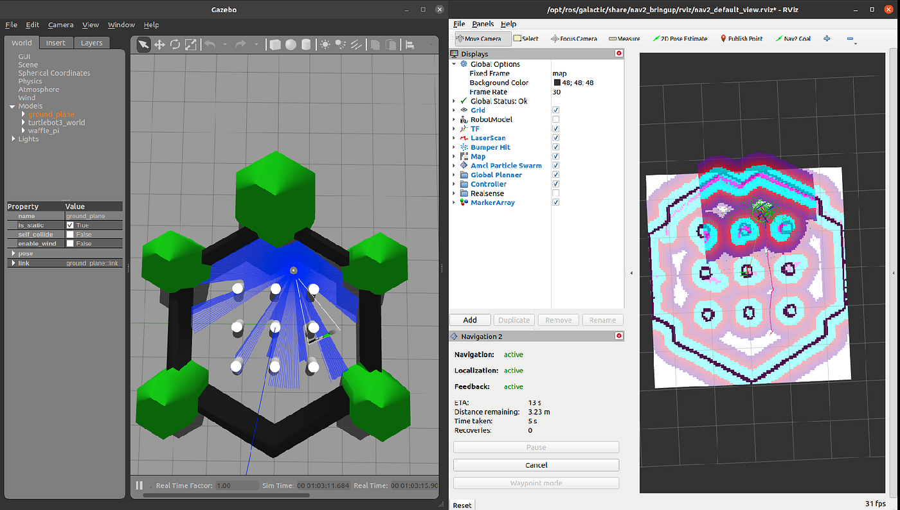

*真实软件截图｜TurtleBot3 在 Gazebo 仿真环境中运行，RViz 同时显示 Nav2 导航状态。注意：这是仿真运行截图，不是实体机器人实拍。*

来源：[ROS 2 Mobile Robotics Series — Part 2（Medium）](https://medium.com/%40thehummingbird/ros-2-mobile-robotics-series-part-2-e8dd6116aacb)

### 真实 Nav2 导航 GIF：机器人绕过障碍前往目标点

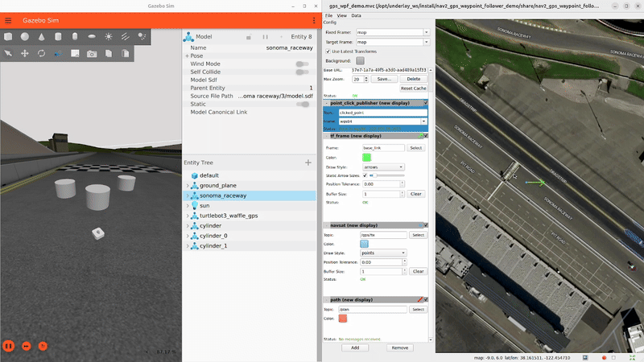

*官方文档中的 Gazebo 导航演示 GIF｜展示机器人沿路线绕过障碍物并前往目标点。该示例属于仿真演示。*

来源：[ROS 2 Navigation2 官方教程](https://docs.nav2.org/tutorials/docs/navigation2_with_gps.html)

**讲解重点：**
前四章介绍了定位、建图、规划和避障的基本原理；这里要让观众看到，这些能力组合后，机器人已经能够在一定场景中自主完成移动任务。

---

# 第二部分：当前技术痛点与未来发展（约 2 分 30 秒）

## 4. 痛点一：动态环境理解能力不足

*图
3｜当前技术痛点概览（自制示意图）：动态环境理解、仿真与现实差距、安全与可靠性。*

传统导航系统对墙壁、桌椅、货架等静态障碍物处理得相对成熟，但面对行人、推车和其他移动机器人时，环境会持续变化。

例如，一个人突然横穿机器人前方。机器人不仅要知道对方现在在哪里，还需要估计对方可能的运动方向，并决定减速、等待还是绕行。

### 未来方向：语义导航与视觉语言模型

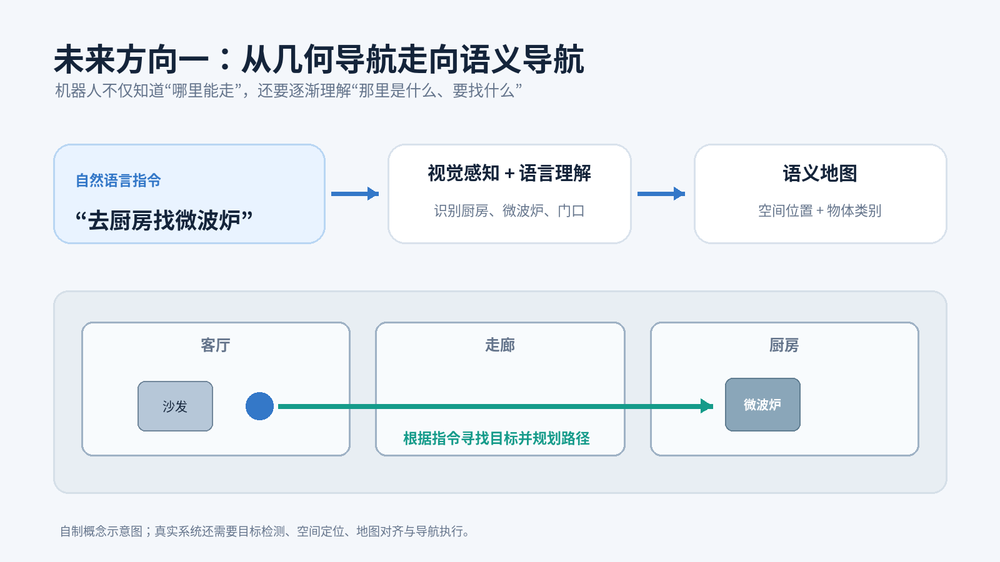

*图
4｜语义导航概念图（自制示意图）。机器人接收"去厨房找微波炉"的指令，结合视觉感知、语言理解和语义地图定位目标，再执行导航。*

- **语义导航（Semantic Navigation）：**
  不仅识别哪里有障碍物，还尝试理解环境中是什么物体、物体具有什么意义。
- **VLM（Vision-Language Model，视觉语言模型）：**
  结合图像与语言理解环境，例如识别厨房、微波炉、行人等。

未来，人可能直接告诉机器人："去厨房找微波炉。"机器人需要理解指令、识别目标、确定目标位置，再调用导航系统完成任务。

### 真实研究演示：机器人根据自然语言寻找环境目标

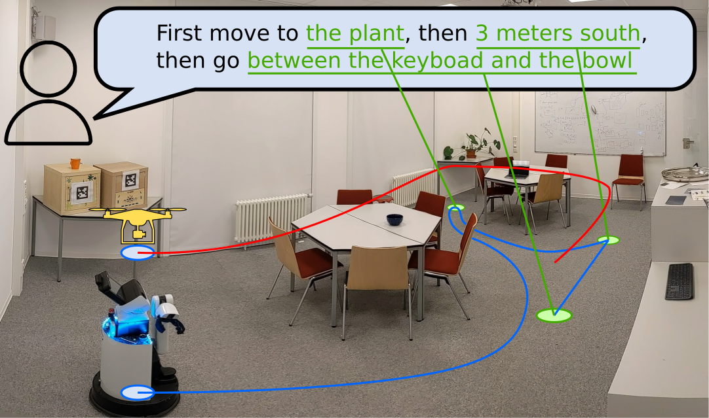

*真实研究场景图｜研究团队展示机器人结合全景视觉和视觉语言模型，根据“去炉子上的水壶”等语言指令理解环境目标。*

来源：[Reflex-Based Open-Vocabulary Navigation without Prior Knowledge](https://haraduka.github.io/omnidirectional-vlm/)

这类能力已经出现真实机器人研究演示，但在开放环境中仍面临识别错误、空间定位偏差和长任务执行不稳定等问题。

**真实研究参考：**

- [LM-Nav：结合语言、视觉与导航模型的机器人导航研究（CoRL
  2023）](https://proceedings.mlr.press/v205/shah23b.html)
- [Open-vocabulary / Vision-Language Robot Navigation
  研究演示](https://haraduka.github.io/omnidirectional-vlm/)

## 5. 痛点二：仿真成功不等于现实成功

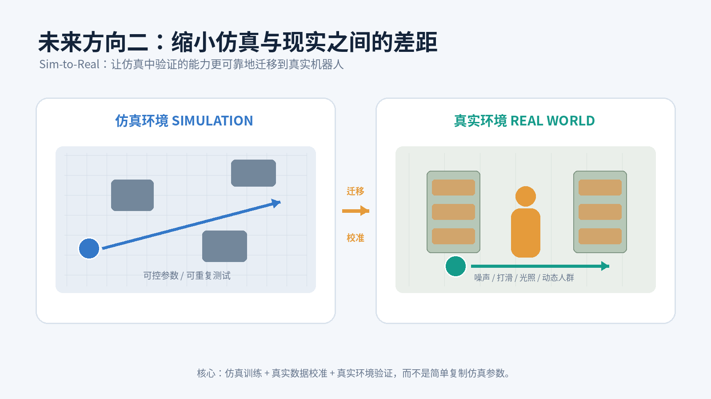

*图 5｜Sim-to-Real
概念对比（自制示意图）。左侧为可控仿真环境，右侧为包含真实地面、动态人员和传感器误差的现实环境。*

仿真环境可以帮助开发者低成本测试算法，但真实机器人会遇到：

- 激光雷达和摄像头的测量噪声；
- 车轮打滑、地面不平和机械误差；
- 光照变化、反光、遮挡和动态障碍物；
- 计算延迟、电量和硬件性能限制。

### 未来方向：数字孪生与 Sim-to-Real

### 真实论文实验图：实体机器人与数字孪生对照

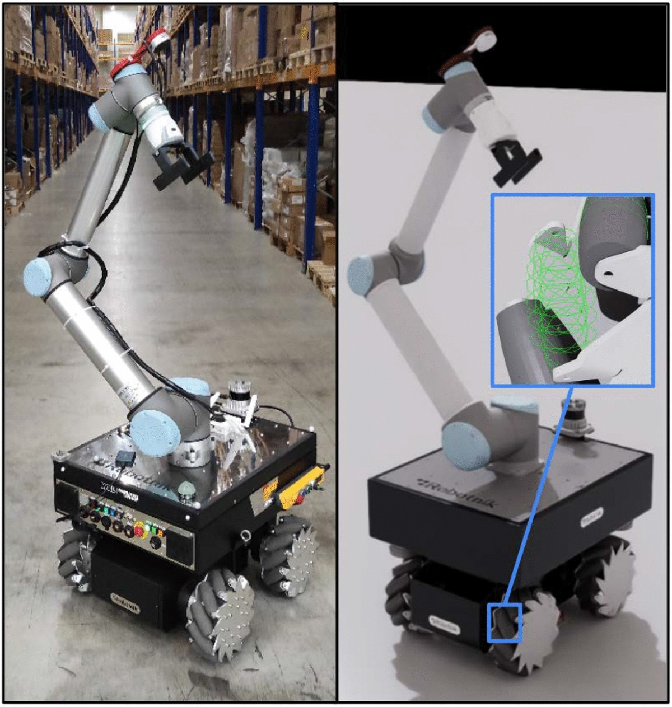

*真实论文实验图｜左侧为真实仓库环境中的移动机械臂，右侧为对应的数字孪生模型。论文于 2025 年发表，并对真实环境与数字孪生环境中的导航表现进行了对照实验。*

来源：[Evaluating mobile robot navigation behavior in flexible assembly systems through digital twin and real-world experiments（Discover Robotics, 2025）](https://link.springer.com/article/10.1007/s44430-025-00010-4)

- **Digital Twin（数字孪生）：**
  在计算机中建立与真实机器人及其工作环境相对应的虚拟模型，用于测试、监测和分析。
- **Sim-to-Real（仿真到现实）：**
  让仿真中训练或验证的算法能够迁移到真实机器人上。

未来的方向不是简单地"把仿真做得更漂亮"，而是让仿真中的物理、传感器和环境变化更接近现实，并通过真实实验持续校准。

**真实研究参考：**

- [2025
  年移动机器人数字孪生与真实环境导航实验（开放论文）](https://link.springer.com/article/10.1007/s44430-025-00010-4)
- [Sim-to-Real 与 Real-to-Sim
  机器人系统实验架构（2021）](https://www.sciencedirect.com/science/article/pii/S2212827121009550)

## 6. 痛点三：安全性、可靠性与协作能力仍需提高

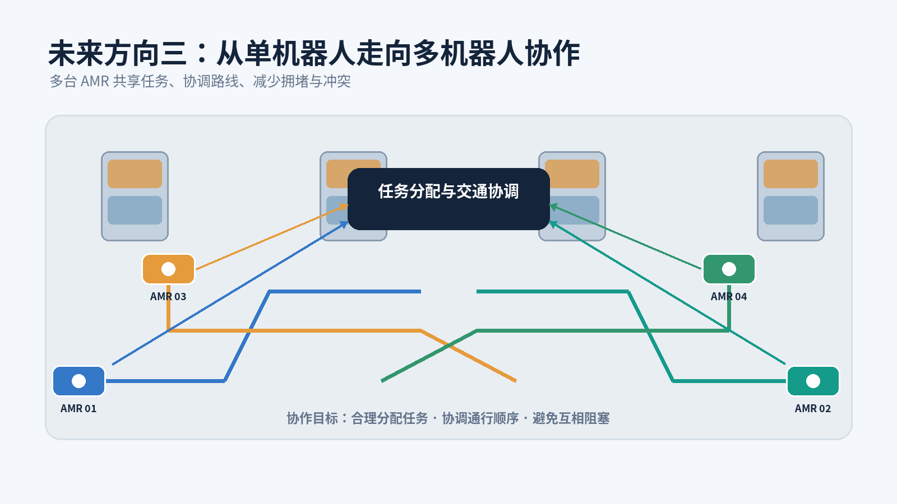

*图 6｜多机器人协同调度概念图（自制示意图）。多台 AMR
共享任务、协调路线和通行顺序，减少相互拥堵。*

机器人进入有人活动的环境后，不能只追求速度和路径最短，还必须考虑：

- 定位或传感器失效时，能否安全停车？
- 通信延迟或计算超时时，能否避免危险动作？
- 多台机器人同时经过狭窄通道时，如何避免冲突？
- 一台机器人故障后，其他机器人能否重新分配任务？

### 未来方向：安全自主与多机器人协作

1. **安全自主：** 识别系统不确定性，在无法确认安全时减速、等待或停止。
2. **多机器人协作：** 多台机器人共享环境信息、分配任务并协调路线。
3. **可靠性验证：**
   不仅测试正常场景，还要测试突发障碍、传感器异常和通信故障。

### 真实仓库照片：多台 AMR 在同一场景中协同工作

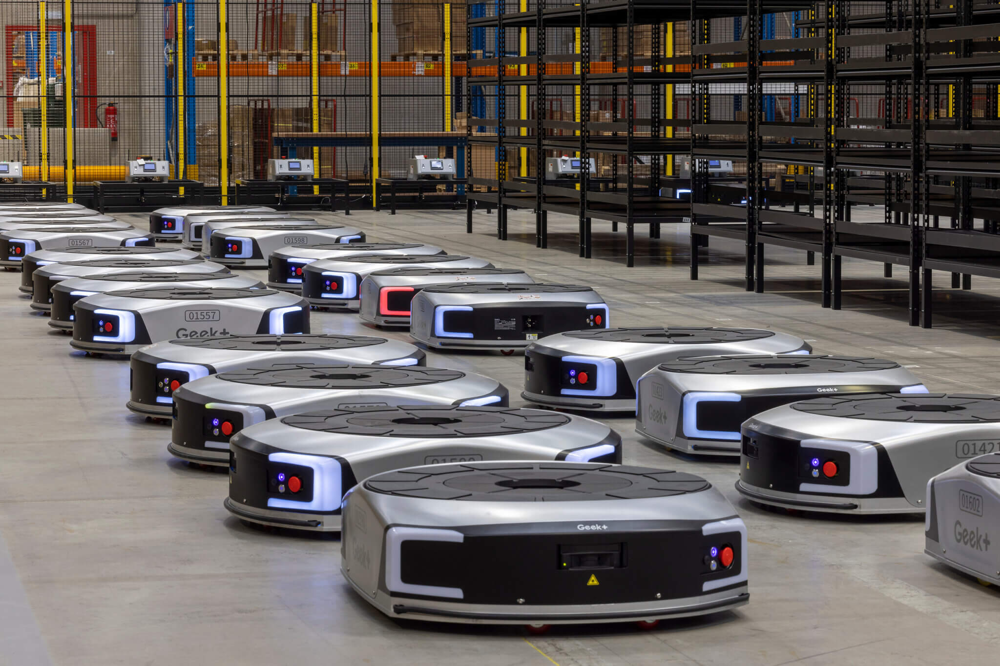

*真实仓储照片｜多台 Geek+ AMR 在仓库地面运行，展示车队规模化部署的实际场景。*

来源：[Katoen Natie：Advantages of Autonomous Mobile Robots](https://consumergoods-industry.katoennatie.com/news/navigating-automations-autonomous-mobile-robots-amrs-technical-and-financial-equilibrium/)

### 真实 GIF：多机器人协同建图

*真实开源项目演示 GIF｜SLAM Toolbox 展示多台机器人交换扫描信息、对齐位姿图并构建共享地图的过程。*

来源：[SLAM Toolbox：Multi-Robot SLAM](https://github.com/SteveMacenski/slam_toolbox)

多机器人数量增加不一定意味着效率提高，还需要解决任务分配、路径冲突、通信和整体调度问题。

---

# 本章总结：从自主移动走向具身智能

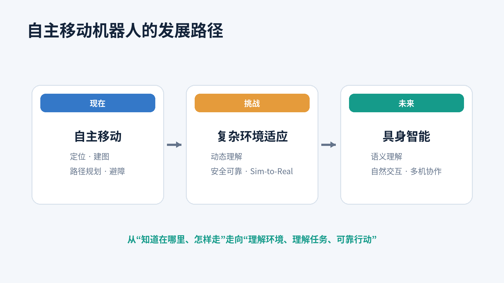

*图
7｜自主移动机器人发展路径（自制示意图）。从现有自主移动能力，经过复杂环境适应与安全可靠性挑战，逐渐走向语义理解、自然交互和多机器人协作。*

可以用三句话概括本章：

- **现在：**
  机器人已经能够在仓库、工厂等场景中实现定位、建图、规划、避障和运输。
- **挑战：** 复杂动态环境、仿真与现实差距、安全可靠性仍是重要问题。
- **未来：**
  机器人将进一步融合视觉、语言、空间理解和自主决策，向更通用的具身智能系统发展。

**建议结束语：**

> 从最初的定位与建图，到如今的自主导航，机器人正在逐渐摆脱对固定路线和人工指令的依赖。但真正的自主移动，不只是让机器人知道自己在哪里、应该往哪里走，更重要的是让它理解周围的世界，适应不断变化的环境，并安全可靠地完成任务。

---

# 五分钟展示安排

  时间         内容                     主要素材

---

  0:00--0:30   自主导航完整流程         图 1
  0:30--1:00   AMR 实际应用             图 2
  1:00--1:45   SLAM 实时建图            GIF 1
  1:45--2:30   动态避障                 GIF 2
  2:30--3:15   动态环境痛点与语义导航   图 3、图 4
  3:15--4:00   仿真与现实差距           图 5
  4:00--4:40   安全性与多机器人协作     图 6
  4:40--5:00   未来展望与总结           图 7

---

# 图片素材说明

本文件夹中的图片分为两类：

1. **自制示意图：** 为本次课程原创绘制，适合直接放入
   PPT，可自由调整配色、裁切和排版。
2. **自制 GIF：** 用于解释 SLAM
   建图和动态避障原理，属于教学原理动画，不应标注为真实机器人实验录像。

真实研究和开源项目的原始素材链接已放在对应章节，正式制作 PPT
时可以从原始项目或论文页面选取更适合的实验截图、GIF，并保留来源说明。

## 素材文件清单

  文件                              类型   推荐用途

---

  `01_自主导航系统闭环.png`         PNG    开场总览
  `02_AMR仓储应用示意.png`          PNG    现有应用
  `03_SLAM实时建图_原理演示.gif`    GIF    建图动态展示
  `04_动态避障_原理演示.gif`        GIF    避障动态展示
  `05_当前技术痛点.png`             PNG    三大痛点总览
  `06_语义导航与自然语言指令.png`   PNG    未来方向一
  `07_Sim2Real仿真到现实.png`       PNG    未来方向二
  `08_多机器人协同调度.png`         PNG    未来方向三
  `09_章节收尾发展路线.png`         PNG    章节总结

## 外部参考资料

- [SLAM Toolbox 官方
  GitHub](https://github.com/SteveMacenski/slam_toolbox)
- [PythonRobotics 算法与 GIF
  演示](https://github.com/AtsushiSakai/PythonRobotics)
- [LM-Nav 论文（CoRL
  2023）](https://proceedings.mlr.press/v205/shah23b.html)
- [数字孪生与移动机器人导航实验（2025）](https://link.springer.com/article/10.1007/s44430-025-00010-4)
- [Sim-to-Real
  机器人系统研究](https://www.sciencedirect.com/science/article/pii/S2212827121009550)

---

## 真实网络素材使用说明

本章真实素材与自制图示应明确区分：

- **真实照片：** Dematic、Katoen Natie 等仓储场景照片。
- **真实软件截图：** RViz、Gazebo、RTAB-Map 的运行画面；其中 Gazebo 画面属于仿真，不是实体机器人实拍。
- **真实研究图片：** 视觉语言导航、VLMaps、数字孪生论文中的实验图片。
- **真实项目 GIF：** SLAM Toolbox 和 ROS 2 Navigation2 官方文档中的项目演示。
- **自制示意图/GIF：** 仅用于解释抽象流程和原理，不应标注为真实实验结果。

### 真实素材总表

| 素材                          | 类型         | 原始来源                                                                                                                                      |
| ----------------------------- | ------------ | --------------------------------------------------------------------------------------------------------------------------------------------- |
| Dematic 仓库 AMR 车队         | 真实照片     | https://www.dematic.com/en-be/insights/articles/how-dematic-software-and-amrs-are-revolutionizing-logistics/                                  |
| Katoen Natie Geek+ AMR 车队   | 真实照片     | https://consumergoods-industry.katoennatie.com/news/navigating-automations-autonomous-mobile-robots-amrs-technical-and-financial-equilibrium/ |
| ROS 2 + Nav2 Gazebo/RViz      | 仿真软件截图 | https://medium.com/@thehummingbird/ros-2-mobile-robotics-series-part-2-e8dd6116aacb                                                           |
| SLAM Toolbox RViz             | 软件运行截图 | https://medium.com/@jiayi.hoffman/robot-auto-mapping-using-nav2-slam-toolbox-40b575433fb0                                                     |
| RTAB-Map 三维点云             | 软件运行截图 | https://www.yahboom.net/public/upload/upload-html/1699598469/11.RTAB-Map%203D%20mapping%20navigation.html                                     |
| 视觉语言导航                  | 研究演示图   | https://haraduka.github.io/omnidirectional-vlm/                                                                                               |
| VLMaps                        | 研究演示图   | https://vlmaps.github.io/                                                                                                                     |
| 数字孪生与实体机器人          | 论文实验图   | https://link.springer.com/article/10.1007/s44430-025-00010-4                                                                                  |
| SLAM Toolbox Circuit Launch   | GIF          | https://github.com/SteveMacenski/slam_toolbox                                                                                                 |
| Nav2 Waypoint Navigation      | GIF          | https://docs.nav2.org/tutorials/docs/navigation2_with_gps.html                                                                                |
| SLAM Toolbox Multi-Robot SLAM | GIF          | https://github.com/SteveMacenski/slam_toolbox                                                                                                 |

> 使用前请查看各来源网站的版权与许可要求。课堂汇报请保留图片来源；若用于公开发布或商业用途，应进一步确认授权条件。
