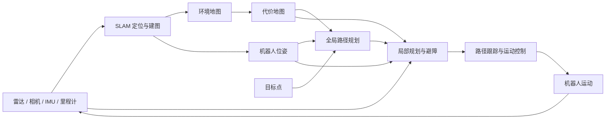

# SLAM 定位、建图与自主移动导航

本仓库是一套面向课程学习与汇报的中文图文资料，带初学者从“机器人怎样认识周围环境”，逐步理解“怎样知道自己在哪里”，最后看懂机器人如何规划路线、避开障碍并实际移动。内容配有图片、GIF 动态演示、真实场景示例和一个可交互的激光测量演示。

## SLAM 是什么

SLAM 是 **Simultaneous Localization and Mapping** 的缩写，通常译为“同步定位与地图构建”。机器人在未知或变化的环境中利用激光雷达、相机、IMU、轮式里程计等传感器观察周围，一边估计自身位置，一边建立环境地图。地图和位姿随后为自主导航提供基础。

可以把自主移动的系统流程概括为：



SLAM 负责提供地图与位置估计；导航系统再结合目标点、代价地图和实时传感器信息规划并执行运动。机器人移动后产生的新观测会继续反馈到系统中。

## 学习路线

| 章节 | 主要内容 | 资料 |
| --- | --- | --- |
| 第一章：SLAM 入门 | SLAM 的含义、基本工作过程、应用场景，以及激光、视觉、多传感器融合等主要类型 | [SLAM 是什么](1/SLAM_第一章_图文增强版.md) · [SLAM 主要种类与真实建图演示](1/SLAM主要种类_图片与GIF完整版.md) |
| 第二章：地图与建图 | 从传感器测量理解地图生成，比较二维栅格、三维点云、体素、特征、拓扑、语义、高程、网格和高斯泼溅地图，并讨论常见建图问题 | [机器人怎样把观测变成地图](2/SLAM第二章_图文教学稿.md) · [激光测量坐标交互演示](2/1.html) |
| 第三章：定位原理 | 里程计、IMU、扫描匹配与回环检测如何帮助机器人估计位置并修正累计误差 | [机器人如何知道自己在哪里](3/第三章_SLAM定位原理_完整图文版.md) |
| 第四章：自主导航 | 地图与代价地图、全局和局部规划、A*、Dijkstra、Hybrid A*、RRT、DWA、路径跟踪及 ROS 导航流程 | [机器人自主导航](4/slam_nav_ch4/第四章_机器人自主导航.md) |
| 第五章：应用与未来 | 自主移动机器人在真实场景中的应用，以及动态环境理解、Sim-to-Real、安全性和多机器人协作等挑战 | [自主移动机器人的现状、挑战与未来](5/第五章_真实图片增强版/第五章_自主移动机器人的现状挑战与未来.md) |

## 仓库内容

- `1/`：SLAM 基础、主要类型和应用示例。
- `2/`：地图表示、建图过程、技术路线与激光测量交互页面。
- `3/`：机器人定位、里程计、IMU、扫描匹配和回环检测。
- `4/`：自主导航、路径规划、避障、路径跟踪与 ROS 导航资料。
- `5/`：机器人应用案例、现实挑战、未来方向和图片来源清单。

Markdown 文档中的图片与 GIF 使用仓库内的相对路径。请保留章节目录和素材目录的结构，直接在 GitHub 浏览，或在本地预览文档，都能找到对应素材。第二章的 `1.html` 是独立交互页面，可在浏览器中打开并拖动角度、距离滑块观察坐标变化。

## 阅读建议

1. 按第一章到第五章的顺序阅读，先建立 SLAM 概念，再连接定位、建图和导航。
2. 阅读第二章时配合 GIF 观察地图如何生成，并比较不同地图表达方式。
3. 阅读第四章时沿“地图与位姿 → 全局规划 → 局部避障 → 路径跟踪与控制”的顺序理解导航系统。
4. 查看图片来源时，参考第五章目录中的素材清单与来源说明。

## 获取资料

```bash
git clone https://github.com/lym2128094758/slam.git
```

本项目定位为 SLAM 与自主移动机器人的课程教学资料，重点讲解概念、算法直觉、系统模块关系和真实演示示例。
